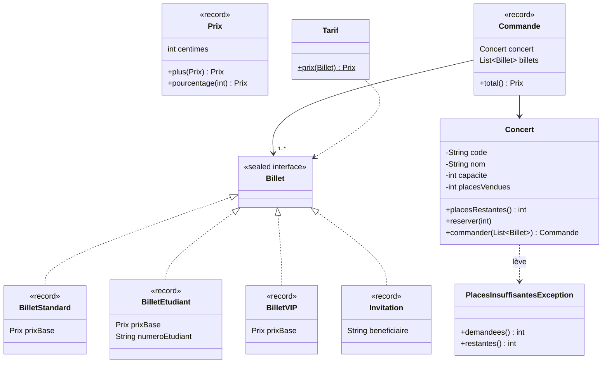

# Cours 2 — Exercices : modéliser

Fil rouge : la billetterie, remodélisée avec les outils du Java moderne (records, types scellés, pattern matching). Le code va dans un nouveau package, `fr.poa.cours02` : votre code du cours 1 reste intact.

Avant de commencer, récupérez les nouveautés :

```bash
git pull --no-edit prof main
```



## Règles

- Votre code va dans `src/main/java/fr/poa/cours02/`, package `fr.poa.cours02`.
- Les noms de classes, de méthodes et d'exceptions sont imposés : respectez-les à la lettre.
- Un montant est désormais un `Prix`, exprimé en centimes (`int`). Quand un calcul tombe entre deux centimes, on arrondit au **centime inférieur**.

## Méthode, pour chaque question

1. Copiez le test indiqué dans `src/test/java/fr/poa/cours02/`, en remplaçant `NomDuTest`.
   macOS / Linux :

```bash
   mkdir -p src/test/java/fr/poa/cours02
   cp exercices/cours-02/tests/NomDuTest.java src/test/java/fr/poa/cours02/
```

Windows (PowerShell) :

```powershell
   New-Item -ItemType Directory -Force src\test\java\fr\poa\cours02
   Copy-Item exercices\cours-02\tests\NomDuTest.java src\test\java\fr\poa\cours02\
```

2. Lancez `./mvnw test` : le test ne compile pas. C'est un test rouge.
3. Créez les classes et les méthodes demandées, vides (une méthode peut renvoyer `0` ou `null`). Le test compile, puis échoue.
4. Codez jusqu'à `BUILD SUCCESS`.

Lisez toujours le test : il dit précisément ce qui est attendu.

À la fin de la séance, sauvegardez votre travail :

```bash
git add src
git commit -m "Cours 2 : exercices"
git push
```

## Exercice 1 — Prix : un record valeur

### Question 1 — Créer un prix

Test : `PrixCreationTest.java`

Créez le record `Prix`, avec un seul composant : `int centimes`. Un prix négatif est refusé par une `IllegalArgumentException`.

<details>
<summary>Indice</summary>

Un record se déclare en une ligne : `public record Prix(int centimes) { }`. Le compilateur génère le constructeur, l'accesseur `centimes()`, `equals`, `hashCode` et `toString`. Pour valider, écrivez un constructeur compact, sans liste de paramètres : `public Prix { ... }`. L'affectation de l'attribut est ajoutée automatiquement à sa fin.

</details>

### Question 2 — Calculer avec des prix

Test : `PrixOperationsTest.java`

Ajoutez à `Prix` :

- la constante `ZERO` (0 centime) ;
- `Prix plus(Prix autre)` : la somme des deux prix ;
- `Prix pourcentage(int pourcent)` : le prix multiplié par `pourcent` / 100, arrondi au centime inférieur.

Un prix ne change jamais : chaque opération renvoie un nouveau `Prix`.

<details>
<summary>Indice</summary>

Une constante : `public static final Prix ZERO = new Prix(0);`. Pour `pourcentage`, restez en `int` : multipliez d'abord, divisez ensuite. Un pourcentage négatif donne un prix négatif, que votre constructeur compact refuse déjà.

</details>

## Exercice 2 — Concert : une entité

### Question 3 — L'égalité d'un concert

Test : `ConcertEgaliteTest.java`

Un concert est identifié par son code, par exemple `"NE-2026"`. Deux objets `Concert` de même code représentent le même concert, même si leur nom ou leur capacité diffèrent (après la correction d'une erreur de saisie, par exemple).

Créez la classe `Concert` :

- un constructeur `Concert(String code, String nom, int capacite)` ;
- les méthodes `String code()`, `String nom()` et `int placesRestantes()` ;
- une capacité nulle ou négative est refusée par une `IllegalArgumentException`, un code `null` par une `NullPointerException` ;
- `equals` et `hashCode`, fondés sur le code uniquement.

<details>
<summary>Indice</summary>

`Objects.requireNonNull(code, "code")` lève la `NullPointerException` si `code` est `null`, et renvoie `code` sinon : on peut l'utiliser directement dans l'affectation.

Les signatures sont imposées par `Object` : `public boolean equals(Object autre)` et `public int hashCode()`, annotées `@Override`. Dans `equals`, l'expression `autre instanceof Concert concert` vérifie le type, écarte `null` et déclare la variable `concert`, le tout en une fois. Pour `hashCode`, réutilisez celui du code : `code.hashCode()`.

</details>

### Question 4 — Pourquoi hashCode ?

Pas de nouveau test.

1. Mettez en commentaire la méthode `hashCode` de `Concert`, puis lancez `./mvnw test -Dtest=ConcertEgaliteTest`. Quels tests échouent ? Pourquoi `deux_concerts_de_meme_code_sont_egaux` passe-t-il encore ?
2. Remettez `hashCode` en place.
3. Pourquoi `Concert` n'est-il pas un record, comme `Prix` ?

### Question 5 — Réserver : une exception métier

Test : `ConcertReservationTest.java`

Ajoutez à `Concert` la méthode `void reserver(int nombre)` :

- un nombre nul ou négatif est refusé par une `IllegalArgumentException` ;
- s'il ne reste pas assez de places, la réservation est refusée par une `PlacesInsuffisantesException`, et le nombre de places restantes ne change pas ;
- sinon, les places restantes diminuent de `nombre`.

Créez `PlacesInsuffisantesException`, une exception non vérifiée. Son message indique le code du concert, et elle expose `int demandees()` et `int restantes()`.

<details>
<summary>Indice</summary>

`public class PlacesInsuffisantesException extends RuntimeException`. Son constructeur reçoit le code du concert, le nombre de places demandées et le nombre de places restantes. Il construit le message et le transmet avec `super(message)`.

Si votre éditeur signale l'absence de `serialVersionUID`, ignorez cet avertissement : il concerne la sérialisation, hors programme.

</details>

## Exercice 3 — Les billets : types scellés et pattern matching

### Question 6 — Une hiérarchie fermée

Test : `BilletHierarchieTest.java`

Il existe exactement quatre sortes de billets. Créez :

- l'interface scellée `Billet`, qui n'autorise que les quatre types ci-dessous et ne déclare aucune méthode ;
- quatre records qui l'implémentent :

| Record           | Composants                               |
| ---------------- | ---------------------------------------- |
| `BilletStandard` | `Prix prixBase`                          |
| `BilletEtudiant` | `Prix prixBase`, `String numeroEtudiant` |
| `BilletVIP`      | `Prix prixBase`                          |
| `Invitation`     | `String beneficiaire`                    |

<details>
<summary>Indice</summary>

`public sealed interface Billet permits BilletStandard, BilletEtudiant, BilletVIP, Invitation { }`, puis, par exemple, `public record BilletVIP(Prix prixBase) implements Billet { }`. Un record est implicitement `final` : il respecte ainsi la règle des types scellés.

</details>

### Question 7 — Le tarif

Test : `TarifTest.java`

Créez la classe `Tarif`, avec la méthode statique `Prix prix(Billet billet)` :

| Billet     | Prix                  |
| ---------- | --------------------- |
| Standard   | le prix de base       |
| Étudiant   | 70 % du prix de base  |
| VIP        | 150 % du prix de base |
| Invitation | gratuit (`Prix.ZERO`) |

Écrivez-la avec un `switch` sur le billet, sans `default`.

<details>
<summary>Indice</summary>

`return switch (billet) { case ... -> ...; };`. Un motif de record teste le type et extrait les composants : `case NomDuRecord(Type composant) -> expression;`. Un composant dont on n'a pas besoin se note `_`, et `case NomDuType _ ->` teste seulement le type.

</details>

### Question 8 — Ce que le compilateur vérifie

Pas de nouveau test.

1. Créez le record `BilletPresse(String media)`, qui implémente `Billet`, et ajoutez-le à la liste `permits`. Lancez `./mvnw test`. Quelle erreur obtenez-vous, et dans quel fichier ?
2. Gardez `BilletPresse`. Dans `Tarif`, remplacez la ligne `case Invitation _ -> ...` par `default -> Prix.ZERO;`, puis relancez `./mvnw test`. Que se passe-t-il ? Combien coûte un billet presse ? Pourquoi est-ce un piège ?
3. Revenez à l'état initial : supprimez `BilletPresse.java`, retirez-le de `permits` et remettez la ligne `case Invitation _ -> ...`. Retirez ensuite `sealed` et `permits` de `Billet`. Pourquoi le `switch` ne compile-t-il plus ? Remettez-les.
4. Au cours 1, chaque classe de billet redéfinissait sa méthode `prix()`. Comparez les deux approches : que faut-il modifier pour ajouter un type de billet ? Pour ajouter une opération (par exemple, le calcul de frais de service) ?

`./mvnw test` doit de nouveau afficher `BUILD SUCCESS`.

## Exercice 4 — La commande : composition et immutabilité

### Question 9 — Une commande

Test : `CommandeTest.java`

Créez le record `Commande`, avec deux composants, `Concert concert` et `List<Billet> billets` :

- le concert est obligatoire : `NullPointerException` ;
- une commande contient au moins un billet (`IllegalArgumentException`), et aucun billet `null` (`NullPointerException`) ;
- une commande ne change jamais : modifier la liste passée au constructeur n'a aucun effet sur la commande, et la liste renvoyée par `billets()` n'est pas modifiable ;
- `Prix total()` renvoie la somme des prix des billets, calculés par `Tarif`.

### Question 10 — Commander

Test : `ConcertCommandeTest.java`

Ajoutez à `Concert` la méthode `Commande commander(List<Billet> billets)` : elle réserve une place par billet et renvoie la commande. Une commande refusée, quelle qu'en soit la raison, ne réserve aucune place.

Pour finir : une `Commande` est-elle vraiment immuable ? Que peut-on encore modifier à travers `commande.concert()` ?
