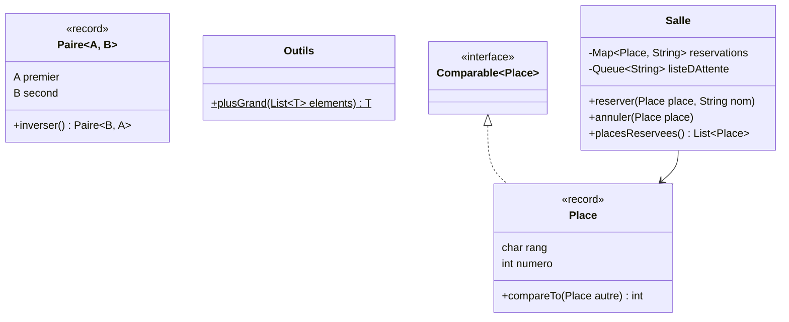

# Cours 3 — Exercices : génériques et collections

La billetterie s'agrandit avec une salle de concert. Chaque place de la salle a un rang, désigné par une lettre, et un numéro dans ce rang. On réserve une place au nom d'un spectateur, et une liste d'attente recueille ceux qui espèrent qu'une place se libère. Avant d'y arriver, vous écrirez deux petits outils génériques.

Le code va dans un nouveau package, `fr.poa.cours03`, et votre code des cours précédents reste intact. Avant de commencer, récupérez les nouveautés :

```bash
git pull --no-edit prof main
```



## Méthode

Votre code va dans `src/main/java/fr/poa/cours03/`. Les noms des classes et des méthodes sont imposés, recopiez-les à la lettre. Pour chaque question :

1. Copiez le test indiqué dans `src/test/java/fr/poa/cours03/`, en remplaçant `NomDuTest`.
   macOS / Linux :

```bash
   mkdir -p src/test/java/fr/poa/cours03
   cp exercices/cours-03/tests/NomDuTest.java src/test/java/fr/poa/cours03/
```

Windows (PowerShell) :

```powershell
   New-Item -ItemType Directory -Force src\test\java\fr\poa\cours03
   Copy-Item exercices\cours-03\tests\NomDuTest.java src\test\java\fr\poa\cours03\
```

2. Lancez `./mvnw test`. Le test ne compile pas encore, c'est normal.
3. Créez les classes et les méthodes demandées, avec un corps vide (une méthode peut renvoyer `0`, `false` ou `null`). Le test compile, puis échoue.
4. Codez jusqu'à obtenir `BUILD SUCCESS`.

Lisez toujours le test, il montre précisément ce qui est attendu.

À la fin de la séance, sauvegardez votre travail :

```bash
git add src
git commit -m "Cours 3 : exercices"
git push
```

## Exercice 1 — Écrire du code générique

### Question 1 — Une paire de valeurs

Le test à copier est `PaireTest.java`.

Créez le record générique `Paire<A, B>`, avec deux composants, `A premier` et `B second`. Ajoutez la méthode `Paire<B, A> inverser()`, qui renvoie une nouvelle paire dont les deux valeurs sont échangées.

<details>
<summary>Indice</summary>

Les types paramètres se déclarent entre chevrons, juste après le nom du record : `public record Paire<A, B>(A premier, B second) { }`. Dans le corps du record, `A` et `B` s'utilisent comme n'importe quel autre type.

</details>

### Question 2 — Le plus grand élément d'une liste

Le test à copier est `OutilsTest.java`.

Créez la classe `Outils` et sa méthode statique `plusGrand`, qui renvoie le plus grand élément d'une liste. Elle doit fonctionner avec des entiers comme avec des textes, et plus tard avec vos propres classes, pourvu que leurs objets sachent se comparer. Une liste vide est refusée par une `IllegalArgumentException`.

```java
public static <T extends Comparable<T>> T plusGrand(List<T> elements)
```

<details>
<summary>Indice</summary>

`<T extends Comparable<T>>` annonce une méthode générique, dont le type `T` sait se comparer à un autre `T`. On compare deux éléments avec `a.compareTo(b)`, qui renvoie un nombre positif quand `a` est le plus grand. Partez du premier élément, puis parcourez la liste en gardant le plus grand rencontré.

</details>

## Exercice 2 — Une salle de concert

### Question 3 — Une place

Le test à copier est `PlaceTest.java`.

Créez le record `Place`, avec deux composants, `char rang` et `int numero`. Le rang est une lettre majuscule, de A à Z, et le numéro vaut au moins 1. `toString()` colle le rang et le numéro, ce qui donne par exemple `B12`.

Une place doit pouvoir se comparer à une autre. `Place` implémente donc `Comparable<Place>`, et sa méthode `compareTo` range les places par rang, puis par numéro à l'intérieur d'un même rang. A2 vient ainsi avant A10, qui vient avant B1.

<details>
<summary>Indice</summary>

`Character.compare(a, b)` compare deux caractères, et `Integer.compare(a, b)` deux entiers. Comparez d'abord les rangs, et ne comparez les numéros que si les rangs sont égaux. Pour `toString`, méfiez-vous de `rang + numero`, qui additionne un caractère et un entier et donne un nombre.

</details>

### Question 4 — Réserver une place

Le test à copier est `SalleReservationTest.java`.

Créez la classe `Salle`. Son constructeur `Salle(char dernierRang, int placesParRang)` fixe ses dimensions. Une salle créée par `new Salle('C', 10)` compte trois rangs, de A à C, de dix places chacun. Un dernier rang qui n'est pas une majuscule, ou un nombre de places inférieur à 1, est refusé par une `IllegalArgumentException`.

Ajoutez ensuite ces méthodes :

- `boolean existe(Place place)`, qui indique si la place fait partie de la salle ;
- `void reserver(Place place, String nom)`, qui réserve la place au nom d'un spectateur ;
- `boolean estLibre(Place place)` ;
- `String occupant(Place place)`, qui renvoie le nom du spectateur qui occupe la place ;
- `List<Place> placesReservees()`, qui renvoie les places réservées, triées, dans une liste qu'on ne peut pas modifier ;
- `int nombreDePlacesLibres()`.

Une place déjà réservée ne peut pas l'être une seconde fois, et une place libre n'a pas d'occupant. Ces deux cas lèvent une `IllegalStateException`. Une méthode qui reçoit une place qui n'existe pas lève une `IllegalArgumentException`.

<details>
<summary>Indice</summary>

Rangez les réservations dans une `Map<Place, String>`, qui associe chaque place réservée au nom de son spectateur. Une `TreeMap` garde ses clés triées grâce à `compareTo`. `List.copyOf(reservations.keySet())` donne alors les places réservées dans l'ordre.

</details>

### Question 5 — La liste d'attente

Le test à copier est `SalleAttenteTest.java`.

Un spectateur qui n'a pas trouvé de place peut s'inscrire sur une liste d'attente. Ajoutez à `Salle` ces méthodes :

- `void inscrireEnAttente(String nom)` ;
- `List<String> listeDAttente()`, qui renvoie les noms dans l'ordre d'arrivée, dans une liste qu'on ne peut pas modifier ;
- `void annuler(Place place)`, qui annule la réservation d'une place.

Quand une place est annulée et que la liste d'attente n'est pas vide, la place revient au premier inscrit, qui quitte alors la liste. Annuler une place libre lève une `IllegalStateException`.

<details>
<summary>Indice</summary>

Une file (`Queue`) sert ses éléments dans leur ordre d'arrivée, comme la file d'attente d'un guichet. `ArrayDeque` en est une implémentation. Sa méthode `add` ajoute un élément à la fin, et `poll` retire le premier, ou renvoie `null` si la file est vide.

</details>

### Question 6 — Compter par rang

Le test à copier est `SalleStatistiquesTest.java`.

Ajoutez à `Salle` la méthode `Map<Character, Integer> reservationsParRang()`, qui compte les places réservées dans chaque rang. Seuls les rangs qui ont au moins une réservation apparaissent, dans l'ordre alphabétique.

## Exercice 3 — Deux pièges des collections

### Question 7 — Trier, ou pas

Cette question n'a pas de nouveau test.

1. Dans `Salle`, remplacez la `TreeMap` des réservations par une `HashMap`, puis lancez `./mvnw test`. Quel test échoue, et pourquoi ? Remettez ensuite la `TreeMap`.
2. Dans `Place`, retirez `implements Comparable<Place>`, ainsi que l'annotation `@Override` de `compareTo`, puis lancez `./mvnw test`. Quelles lignes le compilateur refuse-t-il, et dans quel fichier ?
3. Mettez en commentaire les deux tests qui contiennent ces lignes, et relancez. Quelle exception obtenez-vous, et à quel moment ? Pourquoi le compilateur n'a-t-il rien signalé dans `Salle` ?
4. Remettez tout en place. `./mvnw test` doit de nouveau afficher `BUILD SUCCESS`.

### Question 8 — Retirer pendant un parcours

Le test à copier est `SalleLiberationTest.java`.

Un spectateur qui ne se présente pas perd toutes ses réservations. Ajoutez à `Salle` la méthode `int libererPlacesDe(String nom)`, qui supprime toutes les réservations faites à ce nom et renvoie leur nombre. Les places libérées restent libres, sans passer à la liste d'attente.

Écrivez d'abord cette méthode avec une boucle `for` sur `reservations.keySet()`, qui appelle `reservations.remove(place)` pour chaque place du spectateur. Lancez le test et notez l'exception obtenue. Corrigez ensuite la méthode en parcourant les réservations avec un `Iterator`, et en supprimant avec sa méthode `remove`.
