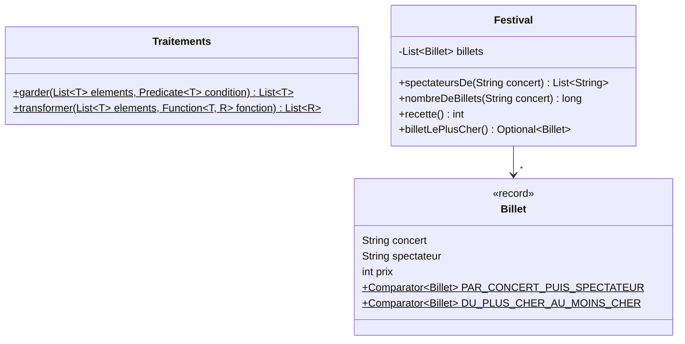

# TD1 — Lambdas et streams

Le festival de la billetterie ouvre ses ventes. Vous écrirez d'abord deux outils qui reçoivent une lambda, puis vous trierez des billets de deux façons, et vous interrogerez enfin les ventes du festival avec des streams. Chaque exercice commence par un court rappel du cours 4.

Le code va dans un nouveau package, `fr.poa.td1`, et votre code des cours précédents reste intact. Avant de commencer, récupérez les nouveautés :

```bash
git pull --no-edit prof main
```



## Méthode

Votre code va dans `src/main/java/fr/poa/td1/`. Les noms des classes et des méthodes sont imposés, recopiez-les à la lettre. Pour chaque question :

1. Copiez le test indiqué dans `src/test/java/fr/poa/td1/`, en remplaçant `NomDuTest`.
   macOS / Linux :

```bash
   mkdir -p src/test/java/fr/poa/td1
   cp exercices/td1/tests/NomDuTest.java src/test/java/fr/poa/td1/
```

Windows (PowerShell) :

```powershell
   New-Item -ItemType Directory -Force src\test\java\fr\poa\td1
   Copy-Item exercices\td1\tests\NomDuTest.java src\test\java\fr\poa\td1\
```

2. Lancez `./mvnw test`. Le test ne compile pas encore, c'est normal.
3. Créez les classes et les méthodes demandées, avec un corps vide (une méthode peut renvoyer `0`, `false` ou `null`). Le test compile, puis échoue.
4. Codez jusqu'à obtenir `BUILD SUCCESS`.

Lisez toujours le test, il montre précisément ce qui est attendu. Dans cet énoncé, « testez » signifie lancer `./mvnw test`.

En séance, faites au moins les questions 1 à 7. Les questions 8 à 10 sont la suite, à faire ensuite, en séance ou chez vous.

À la fin de la séance, sauvegardez votre travail :

```bash
git add src
git commit -m "TD1 : lambdas et streams"
git push
```

## Exercice 1 — Passer un comportement

Une lambda est un petit bout de code qu'on passe en paramètre. Elle implémente une interface qui n'a qu'une seule méthode. `Predicate<T>` répond par oui ou non avec sa méthode `test`, et `Function<T, R>` transforme un `T` en `R` avec sa méthode `apply`. Quand une lambda ne fait qu'appeler une méthode, une référence de méthode la remplace, comme `String::length`.

```java
Predicate<String> court = t -> t.length() <= 4;
Function<String, Integer> taille = String::length;
court.test("Jazz");          // true
taille.apply("Électro");     // 7
```

Les deux méthodes de cet exercice s'écrivent avec une boucle. Les streams viendront à l'exercice 3.

### Question 1 — Garder des éléments

Le test à copier est `TraitementsGarderTest.java`.

Créez la classe `Traitements`, avec un constructeur privé, et sa méthode statique `garder`. Elle renvoie une nouvelle liste, qui contient dans le même ordre les éléments pour lesquels la condition est vraie. La liste reçue n'est jamais modifiée.

```java
public static <T> List<T> garder(List<T> elements, Predicate<T> condition)
```

Par exemple, `Traitements.garder(List.of(1, 2, 3, 4, 5, 6), n -> n % 2 == 0)` renvoie `[2, 4, 6]`.

<details>
<summary>Indice</summary>

Créez une liste vide, parcourez les éléments reçus, et ajoutez ceux pour lesquels `condition.test(element)` renvoie `true`. Comme `plusGrand` au cours 3, la méthode est générique, et `<T>` se déclare avant le type de retour.

</details>

<details>
<summary>Si un test échoue</summary>

- *garder les nombres pairs* obtient `[1, 3, 5]` ⇒ la condition est inversée. On garde les éléments pour lesquels `condition.test` renvoie `true`.
- Une `UnsupportedOperationException` ⇒ la méthode modifie la liste reçue, et une liste créée par `List.of` ne se modifie pas. Construisez une nouvelle liste.
- *la liste recue n est pas modifiee* ⇒ la méthode retire des éléments de la liste reçue au lieu d'en construire une nouvelle.

</details>

### Question 2 — Transformer des éléments

Le test à copier est `TraitementsTransformerTest.java`.

Ajoutez à `Traitements` la méthode statique `transformer`. Elle renvoie une nouvelle liste, qui contient dans le même ordre le résultat de la fonction pour chaque élément, doublons compris.

```java
public static <T, R> List<R> transformer(List<T> elements, Function<T, R> fonction)
```

`Traitements.transformer(List.of("Jazz", "Rock", "Électro"), String::length)` renvoie ainsi `[4, 4, 7]`.

<details>
<summary>Indice</summary>

La méthode a deux types paramètres, `<T, R>`. Elle reçoit des `T` et renvoie une liste de `R`. `fonction.apply(element)` renvoie un `R`, que l'on ajoute à la nouvelle liste.

</details>

<details>
<summary>Si un test échoue</summary>

- *transformer garde les doublons et l ordre* obtient `[JAZZ, ROCK]` ⇒ le résultat passe par un `Set`, qui refuse les doublons. Une `List` les garde.
- Le compilateur refuse `resultat.add(element)` ⇒ la nouvelle liste contient des `R`, et c'est `fonction.apply(element)` qu'il faut y ajouter.

</details>

## Exercice 2 — Trier des billets

Un `Comparator` décrit un ordre sans toucher à la classe. `Comparator.comparing` le fabrique à partir de ce qu'on compare, `thenComparing` ajoute un critère pour départager les égalités, et `reversed` inverse l'ordre obtenu jusque-là. Ces écritures se lisent de gauche à droite.

```java
livres.sort(Comparator.comparing(Livre::annee)
        .reversed()
        .thenComparing(Livre::titre));
// La Main gauche de la nuit, Ubik, Dune, Fondation
```

### Question 3 — Le billet

Le test à copier est `BilletTest.java`.

Créez le record `Billet`, avec trois composants, `String concert`, `String spectateur` et `int prix`. Un concert ou un spectateur vide, ou fait seulement d'espaces, est refusé par une `IllegalArgumentException`, de même qu'un prix négatif. Un prix de 0 est accepté, c'est une invitation.

<details>
<summary>Indice</summary>

Les contrôles se placent dans le constructeur compact du record, `public Billet { ... }`. `isBlank()` refuse aussi un texte fait d'espaces.

</details>

<details>
<summary>Si un test échoue</summary>

- *un concert ou un spectateur vide est refuse* ⇒ un texte fait d'espaces doit aussi être refusé, ce que voit `isBlank` mais pas `isEmpty`. Vérifiez le spectateur autant que le concert.
- *une invitation coute zero* ⇒ un prix de 0 est accepté. Seul un prix négatif est refusé.

</details>

### Question 4 — Deux ordres de tri

Le test à copier est `BilletTriTest.java`.

Ajoutez à `Billet` deux constantes de type `Comparator<Billet>`.

- `PAR_CONCERT_PUIS_SPECTATEUR` range les billets par concert, puis par spectateur pour un même concert, dans l'ordre alphabétique.
- `DU_PLUS_CHER_AU_MOINS_CHER` range les billets par prix décroissant. À prix égal, les spectateurs sont dans l'ordre alphabétique.

Le test trie une liste de billets avec `sort`, en lui passant l'une des deux constantes.

<details>
<summary>Indice</summary>

Une constante se déclare `public static final`, et un record peut en contenir. Écrivez des références de méthode, comme `Billet::prix`. Pour le second ordre, `reversed()` doit inverser le prix seul, avant que `thenComparing` ajoute le spectateur.

</details>

<details>
<summary>Si un test échoue</summary>

- *trier du plus cher au moins cher* obtient `[25, 30, 45, 45, 60]` ⇒ il manque `reversed()`.
- *a prix egal les spectateurs sont dans l ordre alphabetique* obtient Chloé avant Alice ⇒ le second critère manque, ou `reversed()` est placé à la fin et inverse aussi les spectateurs.
- *trier par concert puis par spectateur* ⇒ vérifiez l'ordre des critères. Le concert vient d'abord, et le spectateur ne sert qu'à départager.
- Le compilateur ne trouve pas `prix()` ⇒ avec une lambda suivie de `reversed()`, Java ne devine plus le type du billet. Écrivez `Billet::prix`. La question 10 revient sur ce piège.

</details>

## Exercice 3 — Les ventes du festival

Un stream fait passer les éléments d'une collection d'opération en opération. `filter` garde ceux qui vérifient une condition, `map` les transforme, `distinct` retire les doublons et `sorted` les trie. Une opération terminale produit le résultat, comme `toList()`, `count()`, `anyMatch(...)` ou `max(...)`. `mapToInt` passe à un stream d'`int`, qui sait faire `sum()`.

```java
List<String> titres = livres.stream()
        .filter(livre -> livre.annee() >= 1965)
        .map(Livre::titre)
        .sorted()
        .toList();
// [Dune, La Main gauche de la nuit, Ubik]
```

Dans cet exercice et le suivant, chaque méthode de `Festival` s'écrit avec un stream, sans boucle.

### Question 5 — Les spectateurs d'un concert

Le test à copier est `FestivalSpectateursTest.java`.

Créez la classe `Festival`. Son constructeur `Festival(List<Billet> billets)` garde sa propre copie des billets vendus, pour que l'appelant ne puisse plus la modifier ensuite. Ajoutez ces deux méthodes :

- `List<String> spectateursDe(String concert)`, qui renvoie les noms des spectateurs du concert, sans doublon, dans l'ordre alphabétique, dans une liste qu'on ne peut pas modifier ;
- `long nombreDeBillets(String concert)`, qui compte les billets vendus pour ce concert.

Un spectateur peut acheter plusieurs billets pour le même concert. Il compte alors une fois parmi les spectateurs, mais tous ses billets sont comptés.

<details>
<summary>Indice</summary>

Le constructeur garde une copie faite avec `List.copyOf`. Pour les spectateurs, enchaînez `filter`, `map`, `distinct` et `sorted`, puis terminez par `toList()`. Pour le nombre de billets, `count()` renvoie directement un `long`.

</details>

<details>
<summary>Si un test échoue</summary>

- *un spectateur qui a deux billets n apparait qu une fois* obtient `[Alice, Bruno, Bruno]` ⇒ il manque `distinct()`.
- *les spectateurs d un concert dans l ordre alphabetique* obtient `[Chloé, Alice]` ⇒ il manque `sorted()`.
- *la liste des spectateurs n est pas modifiable* ⇒ terminez par `toList()`, qui renvoie une liste non modifiable, plutôt que par `collect(Collectors.toList())`.
- *compter les billets d un concert* obtient 2 au lieu de 3 ⇒ ce sont les billets qu'on compte, et non les spectateurs. Bruno a deux billets.
- *le festival garde sa propre copie des billets* ⇒ le constructeur garde la liste reçue elle-même. Faites-en une copie avec `List.copyOf`.

</details>

### Question 6 — La recette

Le test à copier est `FestivalRecetteTest.java`.

Ajoutez à `Festival` ces trois méthodes :

- `int recette()`, qui additionne le prix de tous les billets ;
- `boolean aUnBillet(String spectateur)`, qui indique si ce spectateur a au moins un billet ;
- `boolean tousLesBilletsCoutentAuMoins(int prix)`, qui indique si chaque billet coûte au moins ce prix.

<details>
<summary>Indice</summary>

`mapToInt(Billet::prix)` donne un stream d'`int`, qui sait faire `sum()`. `anyMatch` répond à « au moins un ? », et `allMatch` à « tous ? ».

</details>

<details>
<summary>Si un test échoue</summary>

- Le compilateur ne trouve pas `sum()` ⇒ `map(Billet::prix)` donne un `Stream<Integer>`, qui ne sait pas additionner. `mapToInt` donne un stream d'`int`.
- *savoir si un spectateur a un billet* ⇒ c'est `anyMatch` qui répond à « au moins un billet ? », et non `allMatch`.
- *tous les billets coutent au moins un prix* ⇒ un billet à 25 coûte bien au moins 25, et la comparaison est donc `>=`. C'est `allMatch` qui vérifie tous les billets.
- *dans un festival vide aucun billet ne contredit le minimum* ⇒ sur un festival vide, `allMatch` renvoie `true`, puisque aucun billet ne contredit la condition. Il n'y a pas de cas particulier à écrire.

</details>

### Question 7 — Le billet le plus cher

Le test à copier est `FestivalPlusCherTest.java`.

Ajoutez à `Festival` ces deux méthodes :

- `Optional<Billet> billetLePlusCher()`, qui renvoie le billet le plus cher, ou un `Optional` vide quand le festival n'a vendu aucun billet ;
- `int prixLePlusEleve()`, qui renvoie le prix du billet le plus cher, ou 0 quand il n'y a aucun billet.

<details>
<summary>Indice</summary>

`max` attend un comparateur, et renvoie un `Optional<Billet>`. Pour le prix, partez de `billetLePlusCher()`, transformez le billet en prix avec `map`, puis donnez 0 avec `orElse` quand il n'y a rien.

</details>

<details>
<summary>Si un test échoue</summary>

- *le billet le plus cher* obtient le billet à 25 ⇒ c'est `max` qu'il faut, et non `min`.
- Une `NoSuchElementException` « No value present » ⇒ `get()` a été appelé sur un `Optional` vide. `orElse(0)` donne une valeur de secours.
- Le compilateur refuse de convertir `Billet` en `Optional<Billet>` ⇒ `max` renvoie déjà un `Optional`. Renvoyez-le tel quel, sans `get()`.

</details>

## Exercice 4 — Regrouper

`Collectors.groupingBy` range les éléments d'un stream par clé. Avec un second argument, comme `Collectors.counting()`, il calcule une valeur par clé au lieu de garder la liste des éléments. Le résultat est une `HashMap`, dont les clés ne sont pas triées.

```java
Map<Integer, Long> parAnnee = livres.stream()
        .collect(Collectors.groupingBy(
                Livre::annee, Collectors.counting()));
// {1969=2, 1965=1, 1951=1}
```

### Question 8 — Compter par concert

Le test à copier est `FestivalParConcertTest.java`.

Ajoutez à `Festival` la méthode `Map<String, Long> billetsParConcert()`, qui compte les billets vendus pour chaque concert.

<details>
<summary>Indice</summary>

`Collectors.groupingBy(Billet::concert, Collectors.counting())` compte les billets de chaque concert. Le compte est un `Long`.

</details>

<details>
<summary>Si un test échoue</summary>

- Le compilateur parle de `Integer,Long` ⇒ `Collectors.counting()` compte avec des `Long`. Le type de retour est `Map<String, Long>`.
- *compter les billets de chaque concert* obtient des noms de spectateurs ⇒ la clé du regroupement est le concert.

</details>

### Question 9 — La recette de chaque concert

Le test à copier est `FestivalRecetteParConcertTest.java`.

Ajoutez à `Festival` la méthode `Map<String, Integer> recetteParConcert()`, qui additionne le prix des billets de chaque concert. Les concerts y sont rangés dans l'ordre alphabétique.

<details>
<summary>Indice</summary>

`Collectors.summingInt(Billet::prix)` additionne les prix au lieu de les compter. Pour des clés triées, `groupingBy` accepte un argument de plus, placé au milieu, qui fabrique la `Map`, comme `TreeMap::new`.

</details>

<details>
<summary>Si un test échoue</summary>

- *les concerts sont dans l ordre alphabetique* obtient `[Rock en scène, Nuit Électro, Jazz au parc]` ⇒ `groupingBy` fabrique par défaut une `HashMap`. Relisez l'indice.
- Le compilateur parle de `Integer` et de `Long` ⇒ `counting()` compte les billets. Pour additionner les prix, c'est `summingInt`.

</details>

## Exercice 5 — Trois pièges

### Question 10 — Provoquer les erreurs

Cette question n'a pas de nouveau test. Chaque expérience provoque une erreur, que vous lirez avant de remettre le code qui fonctionne.

1. Dans `recette`, remplacez le stream par une variable locale et un `forEach`, puis testez. Quel message le compilateur affiche-t-il, et pourquoi refuse-t-il ce code ?

```java
int total = 0;
billets.forEach(billet -> total += billet.prix());
return total;
```

2. Dans `nombreDeBillets`, rangez le stream dans une variable et servez-vous-en deux fois, puis testez. Il faut ajouter `import java.util.stream.Stream;` en haut du fichier. Quelle exception obtenez-vous, et à quel moment ? Qu'affiche le programme avant de planter ?

```java
Stream<Billet> duConcert = billets.stream()
        .filter(billet -> billet.concert().equals(concert));
System.out.println(duConcert.count() + " billets");
return duConcert.count();
```

3. Dans `Billet`, écrivez `DU_PLUS_CHER_AU_MOINS_CHER` avec une lambda à la place de `Billet::prix`, puis testez. Que dit le compilateur ? Écrivez ensuite `(Billet billet) -> billet.prix()`, et testez de nouveau.

```java
Comparator.comparing(billet -> billet.prix())
        .reversed()
        .thenComparing(Billet::spectateur)
```

À la fin, tous les tests doivent de nouveau réussir.
