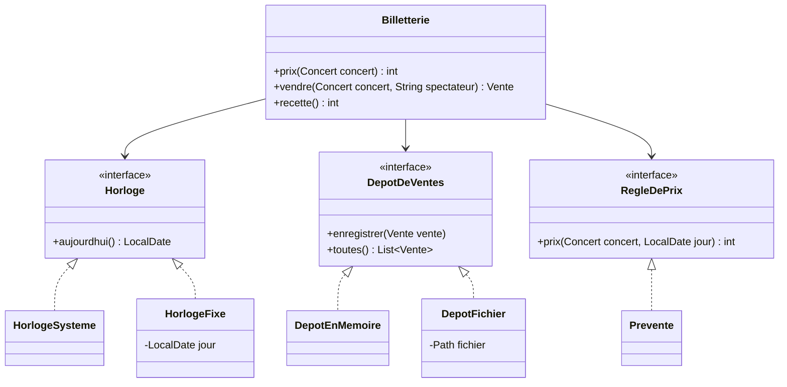

# TD2 — Conception et fichiers

La billetterie du festival vend désormais ses billets elle-même. Elle consulte la date du jour pour accorder la prévente, et elle note chaque vente dans un registre. Vous la construirez d'abord de façon à pouvoir la tester n'importe quel jour, puis vous rangerez ses ventes dans un fichier, et vous sortirez enfin sa règle de prix. Chaque exercice commence par un court rappel du cours 4.

Le code va dans un nouveau package, `fr.poa.td2`, et votre code des cours précédents reste intact. Avant de commencer, récupérez les nouveautés :

```bash
git pull --no-edit prof main
```

Le diagramme montre la billetterie à la fin du TD. Elle ne connaît que trois interfaces, `Horloge`, `DepotDeVentes` et `RegleDePrix`, et chacune a ses implémentations. `RegleDePrix` et `Prevente` n'arrivent qu'à la question 6.



Les deux records du TD, `Concert` et `Vente`, ne figurent pas sur le diagramme. Ils sont décrits dans les questions 2 et 3.

## Méthode

Votre code va dans `src/main/java/fr/poa/td2/`. Les noms des classes et des méthodes sont imposés, recopiez-les à la lettre. Pour chaque question :

1. Copiez le test indiqué dans `src/test/java/fr/poa/td2/`, en remplaçant `NomDuTest`.
   macOS / Linux :

```bash
   mkdir -p src/test/java/fr/poa/td2
   cp exercices/td2/tests/NomDuTest.java src/test/java/fr/poa/td2/
```

Windows (PowerShell) :

```powershell
   New-Item -ItemType Directory -Force src\test\java\fr\poa\td2
   Copy-Item exercices\td2\tests\NomDuTest.java src\test\java\fr\poa\td2\
```

2. Lancez `./mvnw test`. Le test ne compile pas encore, c'est normal.
3. Créez les classes et les méthodes demandées, avec un corps vide (une méthode peut renvoyer `0`, `false` ou `null`). Le test compile, puis échoue.
4. Codez jusqu'à obtenir `BUILD SUCCESS`.

Lisez toujours le test, il montre précisément ce qui est attendu. Dans cet énoncé, « testez » signifie lancer `./mvnw test`.

En séance, faites au moins les questions 1 à 5. Les questions 6 et 7 sont la suite, à faire ensuite, en séance ou chez vous.

À la fin de la séance, sauvegardez votre travail :

```bash
git add src
git commit -m "TD2 : conception et fichiers"
git push
```

## Exercice 1 — Recevoir ses dépendances

Une classe qui demande elle-même la date à `LocalDate.now()` ne se teste vraiment que le jour où l'on lance le test. Au cours 4, le service de prêt recevait plutôt une `Horloge` dans son constructeur. Il ne connaissait que l'interface, et le test lui passait une doublure, qui donne toujours le même jour. C'est l'injection par constructeur. Comme `Horloge` n'a qu'une méthode, une lambda peut aussi servir de doublure.

```java
public ServiceDePret(Horloge horloge) {
    this.horloge = horloge;
}

new ServiceDePret(new HorlogeSysteme());                     // le programme
new ServiceDePret(new HorlogeFixe(LocalDate.of(2026, 3, 2))); // un test
new ServiceDePret(() -> LocalDate.of(2026, 3, 2));           // un test, en lambda
```

Dans ce TD, les prix sont en centimes, pour rester des nombres entiers. `4500` vaut donc 45 €.

### Question 1 — L'horloge

Le test à copier est `HorlogeTest.java`.

Créez l'interface `Horloge`, avec une seule méthode, `LocalDate aujourdhui()`, puis ses deux implémentations.

- `HorlogeSysteme` renvoie la vraie date du jour, avec `LocalDate.now()`.
- `HorlogeFixe` reçoit un jour dans son constructeur, `HorlogeFixe(LocalDate jour)`, et le renvoie à chaque appel. Un jour absent est refusé par une `NullPointerException`.

Au cours 4, la doublure était rangée avec les tests. Ici, elle va dans votre code, à côté des autres classes, pour que les tests fournis puissent s'en servir.

<details>
<summary>Indice</summary>

Une méthode d'interface s'écrit sans corps, et chaque implémentation la redéfinit avec `@Override`. `Objects.requireNonNull(jour, "jour")` lève la `NullPointerException` quand le jour manque, et renvoie le jour sinon. On peut donc le ranger directement dans l'attribut.

</details>

<details>
<summary>Si un test échoue</summary>

- *l horloge fixe donne toujours le meme jour* obtient la date réelle du jour ⇒ `HorlogeFixe` appelle `LocalDate.now()` au lieu de renvoyer le jour reçu.
- *une horloge fixe refuse un jour absent* ⇒ le constructeur doit vérifier le jour avec `Objects.requireNonNull`.
- *horloge est une interface* ⇒ `Horloge` est déclarée comme une classe. Écrivez `public interface Horloge`.

</details>

### Question 2 — Le dépôt en mémoire

Le test à copier est `DepotEnMemoireTest.java`.

Créez d'abord le record `Vente`, avec quatre composants, `String concert`, `String spectateur`, `LocalDate jour` et `int prix`. Un concert, un spectateur ou un jour absent est refusé par une `NullPointerException`. Un concert ou un spectateur vide, ou fait seulement d'espaces, est refusé par une `IllegalArgumentException`, de même qu'un prix négatif. Un prix de 0 est accepté, c'est une invitation.

La billetterie note ses ventes dans un dépôt, comme un guichetier dans son registre. Elle ne sait pas si on lui a confié un carnet qu'on jette le soir ou un registre rangé au coffre, elle sait seulement y écrire et y relire. Créez l'interface `DepotDeVentes`, avec ces deux méthodes.

```java
void enregistrer(Vente vente);
List<Vente> toutes();
```

`enregistrer` ajoute une vente, et `toutes` renvoie les ventes dans l'ordre où elles ont été enregistrées.

Créez ensuite le carnet, `DepotEnMemoire`, qui implémente `DepotDeVentes` en gardant les ventes dans une `ArrayList`. Ses ventes disparaissent à la fin du programme. Sa méthode `toutes` renvoie une liste qu'on ne peut pas modifier, et qui ne change plus quand de nouvelles ventes arrivent.

<details>
<summary>Indice</summary>

Les contrôles du record se placent dans son constructeur compact, comme pour `Billet` au TD1, en commençant par les `Objects.requireNonNull`. Pour `toutes`, `List.copyOf(ventes)` renvoie une copie non modifiable, prise au moment de l'appel.

</details>

<details>
<summary>Si un test échoue</summary>

- *une vente invalide est refusee* ⇒ un texte fait d'espaces doit être refusé, ce que voit `isBlank` mais pas `isEmpty`. Un jour absent doit lever une `NullPointerException`, avec `Objects.requireNonNull`.
- *la liste des ventes n est pas modifiable* ⇒ `toutes` renvoie la liste interne, ou une copie modifiable faite avec `new ArrayList<>(ventes)`. Renvoyez `List.copyOf(ventes)`.
- *une liste deja renvoyee ne change plus* ⇒ la liste renvoyée suit encore la liste interne. Une copie faite avec `List.copyOf` ne bouge plus.
- *depot de ventes est une interface* ⇒ `DepotDeVentes` est déclarée comme une classe. Écrivez `public interface DepotDeVentes`.

</details>

### Question 3 — La billetterie

Le test à copier est `BilletterieTest.java`.

Créez le record `Concert`, avec trois composants, `String nom`, `LocalDate date` et `int prix`, qui est le prix plein. Un nom ou une date absente est refusé par une `NullPointerException`, un nom vide ou fait d'espaces et un prix négatif par une `IllegalArgumentException`.

Créez ensuite la classe `Billetterie`. Son constructeur `Billetterie(Horloge horloge, DepotDeVentes depot)` reçoit ses deux dépendances, et refuse une dépendance absente par une `NullPointerException`. Ajoutez ces trois méthodes :

- `int prix(Concert concert)`, qui renvoie le prix d'un billet acheté aujourd'hui. Un billet acheté au moins 30 jours avant le concert profite de la prévente, et coûte 20 % de moins. Sinon, il coûte le prix plein ;
- `Vente vendre(Concert concert, String spectateur)`, qui crée la vente du jour, au prix du jour, l'enregistre dans le dépôt et la renvoie. Un concert déjà passé ne se vend plus, et lève une `IllegalStateException`. Le jour du concert, on peut encore vendre ;
- `int recette()`, qui additionne le prix de toutes les ventes du dépôt.

Pour la Nuit Électro du 30 décembre 2026, à 4500, un billet coûte ainsi 3600 le 30 novembre, et 4500 à partir du 1er décembre.

La billetterie ne connaît que les interfaces. Elle n'appelle jamais `LocalDate.now()`, et ne crée pas son dépôt elle-même.

<details>
<summary>Indice</summary>

`jour.plusDays(30)` donne le jour situé 30 jours plus tard. S'il tombe après la date du concert, le concert est à moins de 30 jours. Pour 20 % de moins, on paie 80 %, et `prix * 80 / 100` reste un calcul entier. Une méthode privée `calculerPrix(Concert concert, LocalDate jour)` évite d'écrire ce calcul deux fois. La recette se calcule avec un stream sur `depot.toutes()`, comme au TD1.

</details>

<details>
<summary>Si un test échoue</summary>

- *vendre renvoie la vente du jour* obtient la date réelle du jour ⇒ la billetterie appelle `LocalDate.now()`. Demandez la date à l'horloge reçue.
- *a trente jours ou plus la prevente retire vingt pour cent* obtient 4500 au lieu de 3600 ⇒ le trentième jour est exclu. Un billet acheté exactement 30 jours avant le concert profite de la prévente.
- La même question obtient 900 au lieu de 3600 ⇒ le calcul donne la remise, et non le prix. Le spectateur paie 80 % du prix plein.
- Le compilateur parle de `possible lossy conversion from double to int` ⇒ `prix * 0.8` est un `double`. Écrivez `prix * 80 / 100`, qui reste un `int`.
- *vendre enregistre la vente dans le depot* obtient `[]` ⇒ `vendre` n'appelle pas `depot.enregistrer`, ou la billetterie a créé son propre dépôt au lieu de garder celui qu'elle a reçu.
- *la recette additionne les ventes du depot* obtient 7200 au lieu de 9700 ⇒ la billetterie compte ses ventes de son côté. La recette vient du dépôt, qui contient aussi la vente d'Emma, enregistrée avant.
- *le jour du concert on peut encore vendre* lève une `IllegalStateException` ⇒ un concert n'est passé que si sa date est avant aujourd'hui. Comparez avec `isBefore`.
- *les dependances absentes sont refusees* ⇒ vérifiez l'horloge et le dépôt avec `Objects.requireNonNull`.

</details>

## Exercice 2 — Garder les ventes dans un fichier

Au cours 4, `Files.readAllLines` lisait un fichier ligne par ligne, et `split(";")` découpait chaque ligne en champs. L'écriture se fait avec `Files.writeString`. Sans option, elle remplace tout le contenu du fichier. Avec `StandardOpenOption.APPEND`, elle ajoute le texte à la fin, et `StandardOpenOption.CREATE` crée le fichier s'il n'existe pas encore. `Files.exists` dit si un fichier existe.

```java
Path catalogue = Path.of("catalogue.csv");
Files.writeString(catalogue, "Dune;1965\n", StandardOpenOption.CREATE, StandardOpenOption.APPEND);
if (Files.exists(catalogue)) {
    List<String> lignes = Files.readAllLines(catalogue);
}
```

Ces méthodes peuvent lever une `IOException`, qui est vérifiée. Une méthode qui n'a pas le droit de la déclarer l'attrape, et lève à la place une `UncheckedIOException`. Cette exception n'est pas vérifiée, et elle garde l'`IOException` comme cause.

```java
try {
    Files.writeString(catalogue, "Ubik;1969\n", StandardOpenOption.CREATE, StandardOpenOption.APPEND);
} catch (IOException e) {
    throw new UncheckedIOException(e);
}
```

### Question 4 — Une vente par ligne

Le test à copier est `VenteLigneTest.java`.

Ajoutez à `Vente` deux méthodes, qui transforment une vente en ligne de texte, et inversement.

- `String versLigne()` renvoie les quatre composants séparés par des points-virgules, dans l'ordre du record, comme `Nuit Électro;Alice;2026-11-30;3600`.
- `static Vente depuisLigne(String ligne)` relit une telle ligne, et renvoie la vente.

Une ligne qui n'a pas exactement quatre champs, dont la date ou le prix est illisible, ou qui décrit une vente invalide, est refusée par une `IllegalArgumentException`.

<details>
<summary>Indice</summary>

Une `LocalDate` ajoutée à un texte s'écrit au format AAAA-MM-JJ, que `LocalDate.parse` sait relire. Vérifiez `champs.length` avant de lire les champs. `Integer.parseInt` lève une `NumberFormatException`, qui hérite déjà de `IllegalArgumentException`. Ce n'est pas le cas de la `DateTimeParseException` de `LocalDate.parse`, qu'il faut attraper pour lever une `IllegalArgumentException` à la place.

</details>

<details>
<summary>Si un test échoue</summary>

- Une `ArrayIndexOutOfBoundsException` ⇒ la méthode lit les champs sans vérifier qu'il y en a quatre.
- *une date illisible est refusee* obtient une `DateTimeParseException` ⇒ attrapez-la, et levez une `IllegalArgumentException`, en lui passant l'exception d'origine comme cause.
- *relire une ligne* obtient `concert=Alice` ⇒ les champs sont lus dans le désordre. Ils suivent l'ordre du record.
- *une vente tient en une ligne* obtient des virgules ⇒ le séparateur est le point-virgule.

</details>

### Question 5 — Le dépôt dans un fichier

Le test à copier est `DepotFichierTest.java`.

Créez le registre rangé au coffre, `DepotFichier`, qui implémente `DepotDeVentes` en gardant les ventes dans un fichier, une vente par ligne. Son constructeur reçoit le chemin du fichier, `DepotFichier(Path fichier)`.

- `enregistrer` ajoute la ligne de la vente à la fin du fichier, et crée le fichier s'il n'existe pas encore.
- `toutes` relit les ventes du fichier, dans l'ordre. Un fichier qui n'existe pas encore ne contient aucune vente, et les lignes vides sont ignorées. Une ligne illisible lève l'`IllegalArgumentException` de `depuisLigne`.
- Une `IOException` est transformée en `UncheckedIOException`.

Le test travaille dans un dossier temporaire, créé pour chaque test par `@TempDir`, et aucun de vos fichiers n'est touché. Son dernier test fait vendre deux billetteries avec le même fichier, l'une un lundi, l'autre un mardi, et la seconde retrouve la vente de la première. Pour cela, la classe `Billetterie` n'a pas changé d'une ligne.

<details>
<summary>Indice</summary>

N'oubliez pas le retour à la ligne, `vente.versLigne() + "\n"`. Pour relire, partez de `Files.readAllLines(fichier).stream()`, retirez les lignes vides avec `filter`, puis transformez chaque ligne avec la référence de méthode `Vente::depuisLigne`.

</details>

<details>
<summary>Si un test échoue</summary>

- *les ventes sont relues dans l ordre* obtient `[Alice]` au lieu de `[Bruno, Alice]` ⇒ chaque vente remplace le contenu du fichier. Il manque `StandardOpenOption.APPEND`.
- *enregistrer ajoute une ligne au fichier* lève une `UncheckedIOException` due à une `NoSuchFileException` ⇒ `APPEND` seul n'écrit que dans un fichier qui existe déjà. Ajoutez `StandardOpenOption.CREATE`.
- *un fichier absent ne contient aucune vente* lève une `UncheckedIOException` due à une `NoSuchFileException` ⇒ vérifiez avec `Files.exists` avant de lire.
- Une `IllegalArgumentException` montre deux ventes collées sur une même ligne ⇒ il manque le `"\n"` à la fin de chaque ligne écrite.
- *les lignes vides sont ignorees* lève une `IllegalArgumentException` ⇒ retirez les lignes vides avec `isBlank` avant d'appeler `depuisLigne`.
- *un dossier absent leve une unchecked io exception* obtient une `RuntimeException` ⇒ c'est une `UncheckedIOException` qui est attendue.
- *une ligne illisible leve une illegal argument exception* ne lève rien ⇒ `toutes` saute les lignes illisibles. Une ligne abîmée dans le registre est une erreur, qu'il faut signaler.

</details>

## Exercice 3 — La règle de prix

La billetterie calcule encore elle-même la prévente. Pour un tarif étudiant ou des soldes, il faudrait la modifier. Au guichet, la grille des tarifs est une affiche, que l'on remplace sans changer de guichetier. La règle de prix devient donc une interface, que la billetterie reçoit comme ses autres dépendances.

Un constructeur peut en appeler un autre de la même classe avec `this(...)`. C'est utile pour donner une valeur par défaut à une dépendance.

```java
public ServiceDePret() {
    this(new HorlogeSysteme());
}
```

### Question 6 — Une règle interchangeable

Le test à copier est `BilletterieRegleTest.java`.

Créez l'interface `RegleDePrix`, avec la méthode `int prix(Concert concert, LocalDate jour)`, qui donne le prix d'un billet acheté ce jour-là. Déplacez la prévente de la question 3 dans la classe `Prevente`, qui implémente `RegleDePrix`. Nommez ses nombres avec des constantes, comme `JOURS_D_AVANCE`.

Ajoutez à `Billetterie` un second constructeur, `Billetterie(Horloge horloge, DepotDeVentes depot, RegleDePrix regle)`, qui refuse une règle absente. `prix` et `vendre` appliquent désormais la règle reçue. Le constructeur à deux paramètres reste, et il applique la prévente.

Les tests de la question 3 doivent toujours réussir.

<details>
<summary>Indice</summary>

Le calcul privé de la question 3 devient la méthode `prix` de `Prevente`. Le constructeur à deux paramètres se réduit à `this(horloge, depot, new Prevente());`. Le test passe aussi une règle écrite en lambda, `(concert, jour) -> 1000`.

</details>

<details>
<summary>Si un test échoue</summary>

- *vendre applique la regle recue* obtient 3600 au lieu de 2250 ⇒ `vendre` calcule encore la prévente elle-même. Appelez la règle reçue.
- *sans regle la billetterie applique la prevente* obtient 4500 au lieu de 3600 ⇒ le constructeur à deux paramètres doit passer une `Prevente`.
- *une regle absente est refusee* ⇒ vérifiez la règle avec `Objects.requireNonNull`.

</details>

### Question 7 — Provoquer les erreurs

Cette question n'a pas de nouveau test. Chaque expérience provoque une erreur de compilation, que vous lirez avant de remettre le code qui fonctionne.

1. Dans `DepotFichier`, retirez le `try` et le `catch` de `toutes`, en gardant la lecture du fichier, puis testez. Que dit le compilateur, et pourquoi ?

2. Gardez `toutes` sans `try`, et ajoutez `throws IOException` à sa déclaration dans `DepotFichier`. Testez de nouveau. Pourquoi le compilateur refuse-t-il encore ce code ? Pensez à `recette`, qui appelle `toutes` sans savoir quel dépôt la billetterie a reçu.

3. Remettez `toutes` comme avant. Dans `Billetterie`, remplacez partout `DepotDeVentes` par `DepotEnMemoire`, puis testez. Quels tests ne compilent plus ? Que perd la billetterie ?

À la fin, tous les tests doivent de nouveau réussir.
