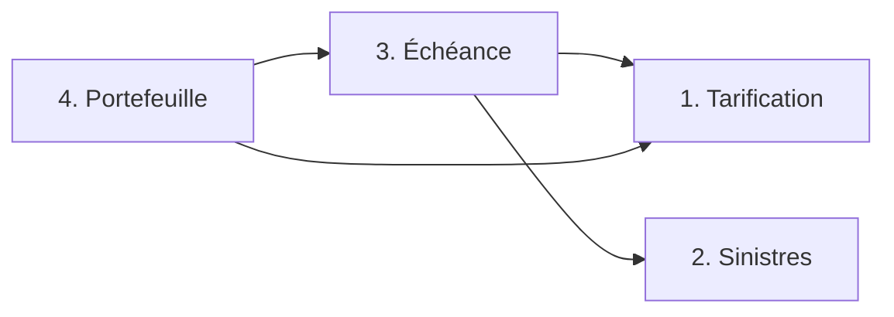
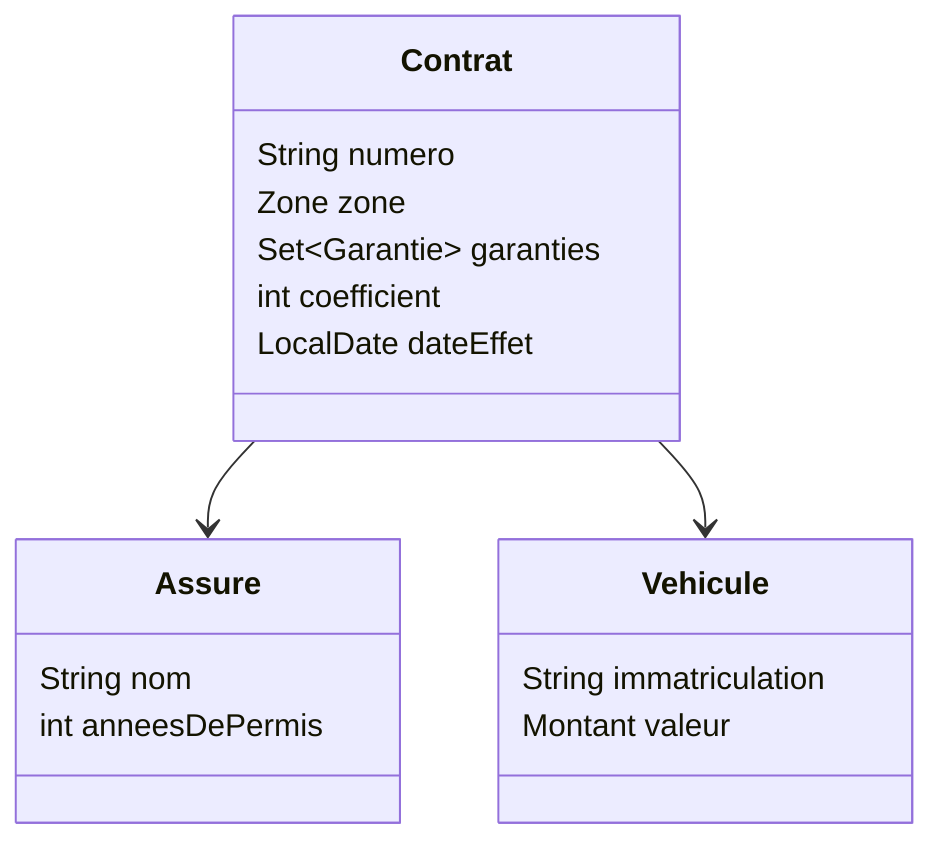

# Cahier des charges AssurAuto

Ce document complète [PROJET.md](PROJET.md). Il décrit les classes que tous les groupes partagent, les méthodes que chaque partie doit offrir et les règles de calcul. Tout ce qui n'y figure pas est libre, et vous pouvez ajouter autant de classes et de méthodes que vous le souhaitez.

Les noms, en revanche, sont imposés. Je corrigerai chaque partie avec mes propres tests, et ces tests appellent exactement les classes et les méthodes décrites ici. Si un nom, un type ou l'ordre des paramètres diffère, mes tests ne compileront pas. Recopiez donc les déclarations telles qu'elles sont écrites.

Si une règle vous paraît ambiguë, posez-moi la question par mail.

## Organisation

Le code se trouve dans le package `fr.poa.assurauto`, avec un sous-package pour le socle et un pour chaque partie.

```
src/main/java/fr/poa/assurauto/
├── socle/
├── tarification/    partie 1
├── sinistres/       partie 2
├── echeance/        partie 3
└── portefeuille/    partie 4
```

Chaque partie est décrite par une interface et implémentée par une classe. Les parties 3 et 4 ont besoin des autres. La partie 3 demande aux sinistres combien d'accidents responsables a eus un contrat, et au tarif la prime d'un contrat. La partie 4 demande au tarif les primes des contrats, et à l'échéance les contrats renouvelés.



Une partie reçoit celles dont elle a besoin dans son constructeur, sous la forme de leur interface. C'est ce qui vous permettra de tester votre partie sans attendre celles des autres. Le programme principal assemble le tout ainsi :

```java
Tarificateur tarificateur = new TarificateurStandard();
ServiceSinistres sinistres = new ServiceSinistresStandard();
ServiceEcheance echeance = new ServiceEcheanceStandard(sinistres, tarificateur);
ServicePortefeuille portefeuille = new ServicePortefeuilleStandard(tarificateur, echeance);
```

Trois règles valent partout. Les montants sont exprimés en centimes, dans un `Montant`, et ne passent jamais par un `double`. Quand un calcul tombe entre deux centimes, on garde le centime inférieur. Enfin, un paramètre `null` provoque une `NullPointerException`, et une valeur interdite une `IllegalArgumentException`.

## Le socle

Un contrat porte un numéro. Il assure un véhicule, conduit par un assuré, dans une zone qui peut être rurale, urbaine ou une grande ville. Il comprend une ou plusieurs garanties parmi la responsabilité civile, le vol, le bris de glace et le tous risques, et la responsabilité civile est obligatoire. Il a aussi un coefficient de bonus-malus et une date d'effet. Un contrat dure un an, et sa date d'échéance tombe donc un an après sa date d'effet.

Un véhicule a une immatriculation et une valeur. Un assuré a un nom et un nombre d'années de permis.



Le coefficient s'écrit en centièmes, comme un pourcentage. Ainsi 90 signifie 0,90 et 125 signifie 1,25. Il reste toujours entre 50 et 350.

Les zones et les garanties sont des énumérations.

```java
package fr.poa.assurauto.socle;

public enum Zone {
    RURALE, URBAINE, GRANDE_VILLE
}
```

```java
package fr.poa.assurauto.socle;

public enum Garantie {
    RESPONSABILITE_CIVILE, VOL, BRIS_DE_GLACE, TOUS_RISQUES
}
```

Les quatre autres classes du socle sont des records. Voici ce qu'ils doivent contenir. Les `...` sont à remplacer par votre code.

```java
public record Montant(int centimes) {

    public static final Montant ZERO = new Montant(0);

    public Montant plus(Montant autre) { ... }

    public Montant pourcentage(int pourcent) { ... }
}
```

```java
public record Assure(String nom, int anneesDePermis) { }
```

```java
public record Vehicule(String immatriculation, Montant valeur) { }
```

```java
public record Contrat(String numero, Assure assure, Vehicule vehicule, Zone zone,
                      Set<Garantie> garanties, int coefficient, LocalDate dateEffet) {

    public LocalDate dateEcheance() { ... }

    public boolean couvre(Garantie garantie) { ... }

    public boolean estEnVigueurLe(LocalDate date) { ... }
}
```

Chaque record vérifie ses données dans un constructeur compact. Un montant n'est jamais négatif. Le nom de l'assuré et l'immatriculation ne sont pas vides, les années de permis ne sont pas négatives, et la valeur du véhicule est strictement positive. Le numéro du contrat n'est pas vide, son coefficient est compris entre 50 et 350, et ses garanties contiennent la responsabilité civile. Le contrat garde une copie de l'ensemble des garanties qu'il reçoit, avec `Set.copyOf`.

`pourcentage(70)` renvoie 70 % du montant, en gardant le centime inférieur. Cette méthode sert aussi à appliquer le coefficient, puisque `pourcentage(90)` multiplie un montant par 0,90.

`dateEcheance()` renvoie la date d'effet plus un an. `couvre(garantie)` indique si le contrat comprend cette garantie. `estEnVigueurLe(date)` indique si la date tombe dans la période du contrat, qui va de la date d'effet incluse à la date d'échéance exclue. Un contrat qui commence le 1er mars 2025 est donc en vigueur du 1er mars 2025 au 28 février 2026.

Un contrat ne change jamais. Quand il est renouvelé, on crée un nouveau `Contrat` qui garde le même numéro.

## Partie 1 — La tarification

```java
package fr.poa.assurauto.tarification;

import fr.poa.assurauto.socle.Contrat;
import fr.poa.assurauto.socle.Montant;

public interface Tarificateur {

    Montant primeAnnuelle(Contrat contrat);
}
```

La classe `TarificateurStandard` implémente cette interface, avec un constructeur sans paramètre.

La prime annuelle se calcule en quatre étapes, dans cet ordre, en gardant le centime inférieur à chaque étape. On additionne d'abord le prix de chaque garantie du contrat.

| Garantie              | Prix par an                  |
| --------------------- | ---------------------------- |
| Responsabilité civile | 300 €                        |
| Vol                   | 1 % de la valeur du véhicule |
| Bris de glace         | 60 €                         |
| Tous risques          | 3 % de la valeur du véhicule |

On applique ensuite la zone, qui donne 85 % de ce montant en zone rurale, 100 % en zone urbaine et 130 % en grande ville. Un assuré qui a moins de 3 ans de permis paie ensuite 50 % de plus. On applique enfin le coefficient de bonus-malus.

Prenons une voiture de 18 000 €, assurée en grande ville pour la responsabilité civile, le vol et le bris de glace. Son conducteur a 2 ans de permis et un coefficient de 90. Les garanties coûtent 300 + 180 + 60 = 540 €. La grande ville porte la prime à 702 €, le jeune conducteur à 1 053 €, et le coefficient la ramène à 947,70 €.

| Véhicule | Garanties              | Zone         | Permis | Coefficient | Prime      |
| -------- | ---------------------- | ------------ | ------ | ----------- | ---------- |
| 18 000 € | RC, vol, bris de glace | grande ville | 2 ans  | 90          | 947,70 €   |
| 9 000 €  | RC, vol                | rurale       | 1 an   | 95          | 472,38 €   |
| 25 000 € | les quatre             | urbaine      | 10 ans | 100         | 1 360,00 € |

## Partie 2 — Les sinistres

Un sinistre a une date, un type et un montant de dommages, qui correspond au coût des réparations du véhicule de l'assuré. Il en existe quatre types.

```java
package fr.poa.assurauto.sinistres;

public enum TypeSinistre {
    ACCIDENT_RESPONSABLE, ACCIDENT_NON_RESPONSABLE, VOL, BRIS_DE_GLACE
}
```

```java
public record Sinistre(LocalDate date, TypeSinistre type, Montant dommages) { }
```

```java
public class SinistreHorsPeriodeException extends RuntimeException { ... }
```

```java
package fr.poa.assurauto.sinistres;

import java.util.List;

import fr.poa.assurauto.socle.Contrat;
import fr.poa.assurauto.socle.Montant;

public interface ServiceSinistres {

    Montant indemnisation(Contrat contrat, Sinistre sinistre);

    void declarer(Contrat contrat, Sinistre sinistre);

    List<Sinistre> sinistresDeclares(String numeroContrat);

    int nombreSinistresResponsables(Contrat contrat);
}
```

La classe `ServiceSinistresStandard` implémente cette interface, avec un constructeur sans paramètre.

`indemnisation` calcule ce que l'assureur rembourse. Il prend les dommages, sans jamais dépasser la valeur du véhicule, et retire une franchise. Le remboursement ne descend jamais sous zéro. Chaque type de sinistre n'est couvert que si le contrat comprend la bonne garantie, sinon l'indemnisation est nulle.

| Type de sinistre         | Garantie nécessaire | Franchise |
| ------------------------ | ------------------- | --------- |
| Accident responsable     | Tous risques        | 300 €     |
| Accident non responsable | Aucune              | Aucune    |
| Vol                      | Vol                 | 250 €     |
| Bris de glace            | Bris de glace       | 50 €      |

Pour une voiture de 18 000 € assurée tous risques, un accident responsable de 2 400 € est remboursé 2 100 €. Un accident responsable de 25 000 € est remboursé 17 700 €, car les dommages sont plafonnés à la valeur du véhicule. Un bris de glace de 40 € n'est pas remboursé, puisqu'il ne dépasse pas la franchise. Sans la garantie tous risques, aucun accident responsable n'est remboursé.

`declarer` enregistre un sinistre pour un contrat. Si la date du sinistre ne tombe pas dans la période du contrat, la méthode lève une `SinistreHorsPeriodeException` et n'enregistre rien. `sinistresDeclares` renvoie les sinistres enregistrés pour un numéro de contrat, dans l'ordre où ils ont été déclarés, dans une liste qu'on ne peut pas modifier. `nombreSinistresResponsables` compte les accidents responsables déclarés pour ce contrat et survenus pendant sa période.

## Partie 3 — Le bonus-malus et l'échéance

```java
package fr.poa.assurauto.echeance;

import java.time.LocalDate;

import fr.poa.assurauto.socle.Contrat;
import fr.poa.assurauto.socle.Montant;

public interface ServiceEcheance {

    int nouveauCoefficient(int coefficient, int sinistresResponsables);

    Contrat renouveler(Contrat contrat);

    Montant remboursement(Contrat contrat, LocalDate dateResiliation);
}
```

La classe `ServiceEcheanceStandard` implémente cette interface. Son constructeur, `ServiceEcheanceStandard(ServiceSinistres sinistres, Tarificateur tarificateur)`, reçoit les deux parties dont elle a besoin.

À chaque échéance, le coefficient évolue selon les sinistres responsables de l'année. Sans sinistre responsable, il est multiplié par 0,95. Sinon, il est multiplié par 1,25 autant de fois qu'il y a eu de sinistres responsables. On garde l'entier inférieur après chaque multiplication, puis on ramène le résultat entre 50 et 350. `nouveauCoefficient` fait ce calcul, et refuse un nombre de sinistres négatif.

| Coefficient | Sinistres responsables | Calcul                                     | Nouveau coefficient |
| ----------- | ---------------------- | ------------------------------------------ | ------------------- |
| 100         | 0                      | 100 × 0,95 = 95                            | 95                  |
| 90          | 1                      | 90 × 1,25 = 112,5                          | 112                 |
| 100         | 2                      | 100 × 1,25 = 125, puis 125 × 1,25 = 156,25 | 156                 |
| 52          | 0                      | 52 × 0,95 = 49,4, ramené au minimum        | 50                  |
| 300         | 1                      | 300 × 1,25 = 375, ramené au maximum        | 350                 |

`renouveler` crée le contrat de l'année suivante. Il garde le numéro, le véhicule, la zone et les garanties. L'assuré y a un an de permis de plus, le coefficient tient compte des sinistres responsables de l'année, et la date d'effet devient l'ancienne date d'échéance. Prenons le contrat à 947,70 € de la partie 1, qui commence le 1er mars 2025, avec un accident responsable le 10 juin 2025. Son renouvellement commence le 1er mars 2026, avec 3 ans de permis et un coefficient de 112. Le conducteur ne paie plus le supplément jeune conducteur, et sa nouvelle prime est de 786,24 €.

Quand un assuré résilie son contrat en cours d'année, il récupère la part de prime des jours restants. `remboursement` calcule la prime annuelle multipliée par le nombre de jours restants, divisée par le nombre de jours de la période, en gardant le centime inférieur. La date de résiliation doit tomber entre la date d'effet et la date d'échéance, ces deux dates comprises. Pour compter les jours entre deux dates, utilisez `ChronoUnit.DAYS.between(debut, fin)`. Si le contrat à 947,70 € est résilié le 1er septembre 2025, il reste 181 jours sur 365, et l'assuré récupère 469,95 €.

## Partie 4 — Le portefeuille

```java
package fr.poa.assurauto.portefeuille;

import java.time.LocalDate;
import java.util.List;
import java.util.Map;

import fr.poa.assurauto.socle.Contrat;
import fr.poa.assurauto.socle.Montant;
import fr.poa.assurauto.socle.Zone;

public interface ServicePortefeuille {

    ResultatImport importer(List<String> lignes);

    Map<Zone, Integer> nombreParZone(List<Contrat> contrats);

    Montant primeTotale(List<Contrat> contrats);

    List<AvisEcheance> avisEcheance(List<Contrat> contrats, LocalDate debut, LocalDate fin);
}
```

```java
public record ResultatImport(List<Contrat> contrats, List<Integer> lignesRejetees) { }
```

```java
public record AvisEcheance(String numeroContrat, String nomAssure, LocalDate dateEcheance, Montant nouvellePrime) { }
```

La classe `ServicePortefeuilleStandard` implémente cette interface. Son constructeur est `ServicePortefeuilleStandard(Tarificateur tarificateur, ServiceEcheance echeance)`.

Dans un groupe de trois, cette partie est partagée. Un membre écrit `importer`, un autre `nombreParZone` et `primeTotale`, le dernier `avisEcheance`, et chacun garde sa propre partie.

`importer` reçoit les lignes d'un fichier CSV. La première ligne est un en-tête, et chaque ligne suivante décrit un contrat en neuf champs séparés par des points-virgules.

```
numero;nom;anneesDePermis;immatriculation;valeur;zone;garanties;coefficient;dateEffet
CT-0001;Alice Martin;2;AB-123-CD;18000;GRANDE_VILLE;RESPONSABILITE_CIVILE,VOL,BRIS_DE_GLACE;90;2025-03-01
CT-0002;Bruno Petit;1;EF-456-GH;9000;RURALE;RESPONSABILITE_CIVILE,VOL;95;2025-04-15
CT-0003;Chloé Diaz;10;IJ-789-KL;25000;URBAINE;VOL;100;2025-05-01

CT-0004;David Morel;5;MN-012-OP;12000;BANLIEUE;RESPONSABILITE_CIVILE;100;2025-06-01
CT-0005;Emma Roux;10;QR-345-ST;25000;URBAINE;RESPONSABILITE_CIVILE,VOL,BRIS_DE_GLACE,TOUS_RISQUES;100;2025-07-01
```

La valeur du véhicule est en euros, sans centimes. Les garanties sont séparées par des virgules, le coefficient est en centièmes, et la date d'effet est au format AAAA-MM-JJ. Une ligne vide est ignorée.

Une ligne invalide est rejetée, et l'import passe à la suivante. Une ligne est invalide quand elle n'a pas neuf champs, quand un nombre, une date, une zone ou une garantie est illisible, ou quand elle ne respecte pas une règle du socle. `importer` renvoie les contrats lus et les numéros des lignes rejetées, en comptant l'en-tête comme ligne 1. Dans l'exemple, la ligne 4 est rejetée parce que le contrat n'a pas de responsabilité civile, et la ligne 6 parce que la zone BANLIEUE n'existe pas. L'import renvoie donc les contrats CT-0001, CT-0002 et CT-0005, et les lignes rejetées 4 et 6.

`nombreParZone` compte les contrats de chaque zone. Les trois zones sont toujours présentes, avec 0 quand aucun contrat ne s'y trouve. `primeTotale` additionne les primes annuelles des contrats. Les trois contrats de l'exemple donnent un contrat par zone et une prime totale de 2 780,08 €.

`avisEcheance` prépare un avis pour chaque contrat dont la date d'échéance tombe entre `debut` et `fin`, ces deux dates comprises. L'avis donne le numéro du contrat, le nom de l'assuré, la date d'échéance et la prime de l'année suivante, c'est-à-dire celle du contrat renouvelé. Les avis suivent l'ordre de la liste reçue. Si `debut` est après `fin`, la méthode lève une `IllegalArgumentException`. Pour les contrats de l'exemple, sans sinistre déclaré, la période du 1er mars au 30 avril 2026 donne deux avis. Alice Martin paiera 596,70 € à partir du 1er mars 2026, et Bruno Petit 447,52 € à partir du 15 avril 2026.

## Tester sa partie

Chacun écrit les tests de sa partie, dans le même package, sous `src/test/java`. Les exemples de ce document sont un bon point de départ, mais pensez aussi aux cas limites.

Pour tester une partie sans dépendre des autres, on remplace celles-ci par des doublures. Une doublure est une petite classe qui implémente une interface et renvoie une réponse fixée à l'avance. Pour tester la partie 3 sans le vrai calcul de prime, on peut écrire cette classe dans `src/test/java/fr/poa/assurauto/echeance/` :

```java
package fr.poa.assurauto.echeance;

import fr.poa.assurauto.socle.Contrat;
import fr.poa.assurauto.socle.Montant;
import fr.poa.assurauto.tarification.Tarificateur;

class TarificateurFixe implements Tarificateur {
    private final Montant prime;

    TarificateurFixe(Montant prime) {
        this.prime = prime;
    }

    @Override
    public Montant primeAnnuelle(Contrat contrat) {
        return prime;
    }
}
```

`new ServiceEcheanceStandard(sinistres, new TarificateurFixe(new Montant(94770)))` crée alors un service dont la prime vaut toujours 947,70 €.

Les 6 points « tests » de votre note individuelle se partagent à parts égales entre mes tests et les vôtres. Dans un groupe de trois, votre méthode de la partie 4 compte pour un quart de votre note individuelle.
