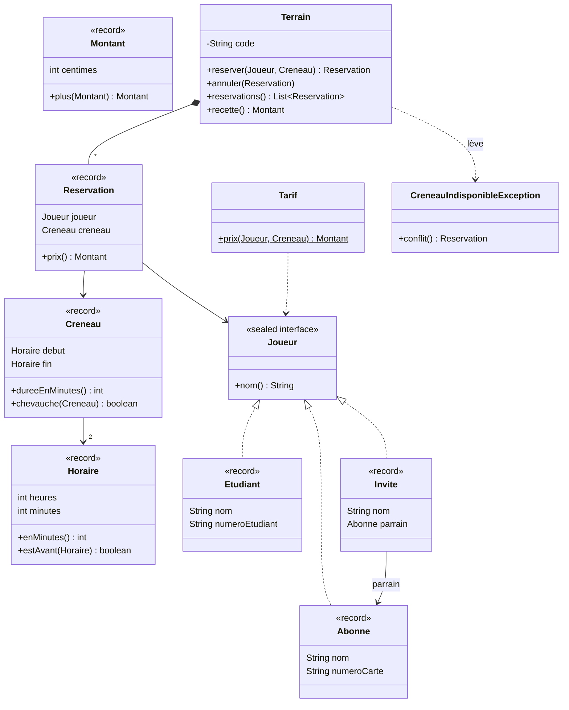

# TP1 — Les réservations d'un club de tennis

TP individuel, fait hors séance. Il porte sur les cours 1 et 2. À rendre avant le début de la séance 8.

## Le sujet

Le club de tennis du campus loue ses terrains. Vous écrivez le cœur de son logiciel : les horaires et les créneaux, les joueurs et leurs tarifs, les réservations d'un terrain et sa recette.



## Règles

- Votre code va dans `src/main/java/fr/poa/tp1/`, package `fr.poa.tp1`.
- Chaque fichier commence par cet en-tête, avant la ligne `package` :

```java
  /*
   * NOM Prénom — N° étudiant : 12345678
   */
```

- Les noms des classes, des méthodes et des exceptions, ainsi que l'ordre des composants des records, sont imposés ... respectez-les à la lettre.
- Les montants sont en centimes, de type `int`. Jamais de `double`.
- N'utilisez pas `java.time`, le but est d'écrire vos propres valeurs.
- Ne modifiez pas les tests fournis.

## Méthode

Avant de commencer, récupérez les nouveautés :

```bash
git pull --no-edit prof main
```

Pour chaque question :

1. Copiez le test indiqué dans `src/test/java/fr/poa/tp1/`, en remplaçant `NomDuTest`.
   macOS / Linux :

```bash
   mkdir -p src/test/java/fr/poa/tp1
   cp tp/tp1/tests/NomDuTest.java src/test/java/fr/poa/tp1/
```

Windows (PowerShell) :

```powershell
   New-Item -ItemType Directory -Force src\test\java\fr\poa\tp1
   Copy-Item tp\tp1\tests\NomDuTest.java src\test\java\fr\poa\tp1\
```

2. Créez les classes et les méthodes demandées, d'abord vides (une méthode peut renvoyer `0`, `false` ou `null`), pour que le test compile.
3. Codez jusqu'à ce que `./mvnw test` affiche `BUILD SUCCESS`.

Lisez toujours le test ! Il précise ce qui est attendu. Mais les tests fournis ne vérifient pas tout : **l'énoncé fait foi**.

Sauvegardez votre travail régulièrement :

```bash
git add src
git commit -m "TP1 : question 3"
git push
```

## Évaluation

| Critère               | Points |
| --------------------- | ------ |
| Tests fournis         | 10     |
| Tests supplémentaires | 6      |
| Lecture du code       | 4      |

- **Tests fournis** : la note est proportionnelle au nombre de tests réussis.
- **Tests supplémentaires** : ils ne sont pas fournis. Ils vérifient les règles de l'énoncé que les tests fournis ne couvrent pas, en particulier les cas limites. Lisez chaque règle attentivement.
- **Lecture du code** : encapsulation et immutabilité, validations au bon endroit, exceptions adaptées, lisibilité, respect des consignes de ce document.
- Une classe de tests qui ne compile pas avec votre code vaut 0. Si votre code ne compile pas du tout, seule la lecture du code est notée.

## Rendu

Un zip du dossier `src/main/java/fr/poa/tp1/`, nommé `TP1_NOM_Prenom_NumEtudiant.zip`, envoyé par mail avant le début de la séance 8. Les commandes sont dans `README.md`, section « Les TP ».

Avant d'envoyer : tous les tests fournis sont copiés, `./mvnw test` affiche `BUILD SUCCESS`, et chaque fichier commence par l'en-tête.

## Partie 1 — Les valeurs

### Question 1 — Horaire

Test : `HoraireTest.java`

Créez le record `Horaire`, avec deux composants : `int heures` et `int minutes`.

- Les heures vont de 0 à 23, les minutes de 0 à 59. Toute autre valeur est refusée par une `IllegalArgumentException`.
- `int enMinutes()` renvoie le nombre de minutes écoulées depuis minuit : 510 pour 08:30.
- `boolean estAvant(Horaire autre)` indique si cet horaire est **strictement** antérieur à `autre`.
- `toString()` renvoie les heures et les minutes, chacune sur deux chiffres, séparées par `:` : `08:30`, `14:05`, `00:00`.

<details>
<summary>Indice</summary>

Validez dans un constructeur compact. Un record peut redéfinir `toString`, avec `@Override`. `String.format("%02d:%02d", heures, minutes)` écrit chaque nombre sur deux chiffres, complété à gauche par un zéro.

</details>

### Question 2 — Créneau

Test : `CreneauTest.java`

Créez le record `Creneau`, avec deux composants : `Horaire debut` et `Horaire fin`.

- Le début et la fin sont obligatoires : `NullPointerException`.
- Le début doit être strictement avant la fin : `IllegalArgumentException` sinon. Un créneau de 10:00 à 10:00 est donc refusé.
- `int dureeEnMinutes()` renvoie la durée du créneau : 90 pour 10:00–11:30.
- `boolean chevauche(Creneau autre)` indique si les deux créneaux ont au moins une minute en commun. Deux créneaux qui se touchent ne se chevauchent pas : 10:00–11:00 et 11:00–12:00 sont compatibles. Un créneau inclus dans un autre le chevauche.

<details>
<summary>Indice</summary>

Dessinez deux segments sur une ligne de temps. Deux créneaux se chevauchent si chacun commence avant que l'autre ne finisse. Utilisez `estAvant`.

</details>

### Question 3 — Montant

Test : `MontantTest.java`

Créez le record `Montant`, avec un seul composant : `int centimes`.

- Un montant négatif est refusé : `IllegalArgumentException`.
- La constante `ZERO` vaut 0 centime.
- `Montant plus(Montant autre)` renvoie la somme des deux montants.
- `toString()` renvoie les euros, une virgule, les centimes sur deux chiffres, une espace ordinaire et le symbole € : `12,50 €`, `0,05 €`, `7,00 €`.

<details>
<summary>Indice</summary>

`centimes / 100` donne les euros, `centimes % 100` les centimes restants. N'utilisez pas `%.2f` : il travaille en `double`, et son séparateur décimal dépend de la langue de la machine.

</details>

## Partie 2 — Les joueurs et le tarif

### Question 4 — Les joueurs

Test : `JoueurTest.java`

Créez l'interface scellée `Joueur`. Elle déclare une seule méthode, `String nom()`, et n'autorise que trois types, tous des records :

| Record     | Composants                            |
| ---------- | ------------------------------------- |
| `Abonne`   | `String nom`, `String numeroCarte`    |
| `Etudiant` | `String nom`, `String numeroEtudiant` |
| `Invite`   | `String nom`, `Abonne parrain`        |

- Un numéro étudiant compte exactement 8 chiffres, sans aucun autre caractère : `IllegalArgumentException` sinon.
- Un invité a toujours un parrain, qui est un abonné : `NullPointerException` si `parrain` vaut `null`.

<details>
<summary>Indice</summary>

Un record implémente une méthode d'interface grâce à son accesseur : le composant `nom` fournit déjà la méthode `nom()`. Pour le numéro étudiant, `texte.matches("[0-9]{8}")` vérifie qu'une chaîne est formée d'exactement 8 chiffres.

</details>

### Question 5 — Le tarif

Test : `TarifTest.java`

Créez la classe `Tarif`, avec la méthode statique `Montant prix(Joueur joueur, Creneau creneau)`.

| Joueur                                        | Tarif horaire                   |
| --------------------------------------------- | ------------------------------- |
| Abonné                                        | 0 € (compris dans l'abonnement) |
| Étudiant                                      | 7,50 €                          |
| Invité, créneau qui commence avant 12:00      | 10,50 €                         |
| Invité, créneau qui commence à 12:00 ou après | 14,00 €                         |

- Seul l'horaire de début compte : un invité qui joue de 11:30 à 13:30 paie tout le créneau au tarif de 10,50 €.
- Le prix est proportionnel à la durée : tarif horaire × durée en minutes / 60, arrondi au centime inférieur.
- Le tarif se calcule avec un `switch` sur le joueur, sans `default`. `Joueur` ne déclare aucune autre méthode que `nom()`.

| Exemple               | Prix                      |
| --------------------- | ------------------------- |
| Étudiant, 10:00–11:00 | 7,50 €                    |
| Étudiant, 10:00–10:45 | 5,62 € (5,625 €, arrondi) |
| Invité, 10:00–11:30   | 15,75 €                   |
| Invité, 14:00–15:00   | 14,00 €                   |

## Partie 3 — Le terrain

### Question 6 — La réservation

Test : `ReservationTest.java`

Créez le record `Reservation`, avec deux composants : `Joueur joueur` et `Creneau creneau`.

- Le joueur et le créneau sont obligatoires : `NullPointerException`.
- `Montant prix()` renvoie le prix de la réservation, selon le tarif de la question 5.

### Question 7 — Le terrain

Test : `TerrainTest.java`

Créez la classe `Terrain`. Un terrain est identifié par son code, par exemple `"T1"`.

- Le constructeur `Terrain(String code)` refuse un code `null` : `NullPointerException`.
- `String code()` renvoie le code.
- Deux terrains de même code sont égaux, quelles que soient leurs réservations.
- Les attributs sont privés, et aucune méthode ne commence par `set`.

### Question 8 — Réserver

Test : `TerrainReservationTest.java`

Ajoutez à `Terrain` :

- `Reservation reserver(Joueur joueur, Creneau creneau)`, qui enregistre la réservation et la renvoie.
  - Si le créneau chevauche une réservation existante, la réservation est refusée par une `CreneauIndisponibleException`, et le terrain ne change pas.
  - Deux créneaux qui se touchent peuvent être réservés tous les deux.
  - Un même joueur peut réserver plusieurs créneaux.
- `List<Reservation> reservations()`, qui renvoie les réservations dans l'ordre où elles ont été faites. La liste renvoyée n'est pas modifiable, et elle ne change plus ensuite : une réservation faite après l'appel n'y apparaît pas.

Créez `CreneauIndisponibleException`, une exception non vérifiée. Son message indique le code du terrain, et sa méthode `Reservation conflit()` renvoie la réservation existante qui chevauche le créneau demandé.

### Question 9 — Annuler

Test : `TerrainAnnulationTest.java`

Ajoutez à `Terrain` la méthode `void annuler(Reservation reservation)`, qui retire la réservation.

- Annuler une réservation inconnue du terrain, qu'elle n'ait jamais été faite ou qu'elle soit déjà annulée, est refusé : `IllegalArgumentException`.
- Une fois annulé, le créneau peut être réservé à nouveau.

### Question 10 — La recette

Test : `TerrainRecetteTest.java`

Ajoutez à `Terrain` la méthode `Montant recette()`, qui renvoie la somme des prix des réservations en cours. Les réservations annulées ne comptent pas. Chaque prix est arrondi séparément, puis les prix sont additionnés. Un terrain sans réservation a une recette nulle.
