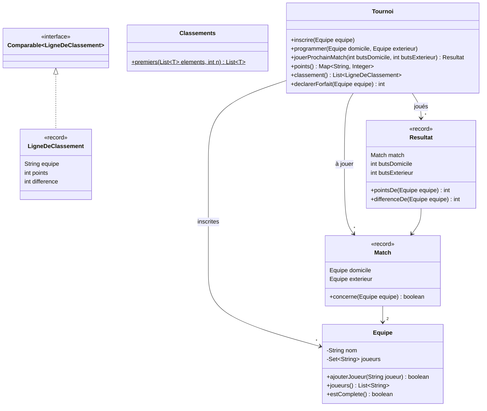

# TP2 — Le tournoi de baby-foot

TP individuel, fait hors séance. Il porte sur le cours 3, génériques et collections. À rendre avant le début de la séance des soutenances.

## Le sujet

Le bureau des étudiants organise un tournoi de baby-foot. Chaque équipe compte deux joueurs. Les matchs sont programmés à l'avance, puis joués dans l'ordre où ils ont été programmés. Une victoire rapporte 3 points, un match nul 1 point, une défaite aucun. Vous écrivez le logiciel du tournoi, avec les équipes, les matchs et leurs résultats, les inscriptions, la file des matchs à jouer et le classement.



Une équipe a un nom et deux joueurs. Un match oppose l'équipe qui reçoit, `domicile`, à l'équipe qui se déplace, `exterieur`. Un résultat est le score d'un match. Le tournoi garde les équipes inscrites, la file des matchs à jouer et la liste des résultats, et il en tire les points et le classement. La classe `Classements`, à part, contient une méthode générique.

## Règles

- Votre code va dans `src/main/java/fr/poa/tp2/`, package `fr.poa.tp2`.
- Chaque fichier commence par cet en-tête, avant la ligne `package` :
  ```java
  /*
   * NOM Prénom — N° étudiant : 12345678
   */
  ```
- Les noms des classes et des méthodes, ainsi que l'ordre des composants des records, sont imposés. Respectez-les à la lettre.
- Ce TP s'appuie sur le cours 3. Les lambdas et les streams ne sont pas nécessaires.
- Ne modifiez pas les tests fournis.

## Méthode

Avant de commencer, récupérez les nouveautés :

```bash
git pull --no-edit prof main
```

Pour chaque question :

1. Copiez le test indiqué dans `src/test/java/fr/poa/tp2/`, en remplaçant `NomDuTest`.
   macOS / Linux :
   ```bash
   mkdir -p src/test/java/fr/poa/tp2
   cp tp/tp2/tests/NomDuTest.java src/test/java/fr/poa/tp2/
   ```
   Windows (PowerShell) :
   ```powershell
   New-Item -ItemType Directory -Force src\test\java\fr\poa\tp2
   Copy-Item tp\tp2\tests\NomDuTest.java src\test\java\fr\poa\tp2\
   ```
2. Créez les classes et les méthodes demandées, d'abord vides (une méthode peut renvoyer `0`, `false` ou `null`), pour que le test compile.
3. Codez jusqu'à ce que `./mvnw test` affiche `BUILD SUCCESS`.

Lisez toujours le test, il précise ce qui est attendu. Mais les tests fournis ne vérifient pas tout, et **l'énoncé fait foi**.

Sauvegardez votre travail régulièrement :

```bash
git add src
git commit -m "TP2 : question 3"
git push
```

## Évaluation

| Critère | Points |
|---|---|
| Tests fournis | 10 |
| Tests supplémentaires | 6 |
| Lecture du code | 4 |

- **Tests fournis.** La note est proportionnelle au nombre de tests réussis.
- **Tests supplémentaires.** Ils ne sont pas fournis. Ils vérifient les règles de l'énoncé que les tests fournis ne couvrent pas, en particulier les cas limites. Lisez chaque règle attentivement.
- **Lecture du code.** On regarde l'encapsulation, le choix des collections, les validations, les exceptions, la lisibilité et le respect des consignes de ce document.
- Une classe de tests qui ne compile pas avec votre code vaut 0. Si votre code ne compile pas du tout, seule la lecture du code est notée.

## Rendu

Un zip du dossier `src/main/java/fr/poa/tp2/`, nommé `TP2_NOM_Prenom_NumEtudiant.zip`, envoyé par mail avant le début de la séance des soutenances. Les commandes sont dans `README.md`, section « Les TP », en remplaçant `tp1` par `tp2`.

Avant d'envoyer, vérifiez que tous les tests fournis sont copiés, que `./mvnw test` affiche `BUILD SUCCESS`, et que chaque fichier commence par l'en-tête.

## Partie 1 — Les équipes et les matchs

### Question 1 — L'équipe

Le test à copier est `EquipeTest.java`.

Créez la classe `Equipe`. Son constructeur `Equipe(String nom)` refuse un nom absent par une `NullPointerException`, et un nom vide ou fait d'espaces par une `IllegalArgumentException`. Ajoutez-lui ces méthodes :
- `String nom()` ;
- `boolean ajouterJoueur(String joueur)`, qui ajoute un joueur à l'équipe et renvoie `true`. Un joueur absent est refusé par une `NullPointerException`. Un joueur déjà présent n'est pas ajouté une seconde fois, et la méthode renvoie alors `false`, même si l'équipe est complète. Une équipe qui a déjà deux joueurs refuse tout nouveau joueur par une `IllegalStateException` ;
- `List<String> joueurs()`, qui renvoie les noms des joueurs dans l'ordre alphabétique, dans une liste qu'on ne peut pas modifier et qui ne change plus ensuite ;
- `boolean estComplete()`, qui indique si l'équipe a ses deux joueurs.

Une équipe est identifiée par son nom. Deux équipes de même nom sont égales, quels que soient leurs joueurs, et `toString()` renvoie le nom.

<details>
<summary>Indice</summary>

Un `TreeSet` refuse les doublons et garde ses éléments triés. Sa méthode `add` renvoie `false` quand l'élément y est déjà. `List.copyOf(joueurs)` en fait une copie non modifiable, qui garde l'ordre. Pour `equals` et `hashCode`, inspirez-vous de la classe `Terrain` du TP1.

</details>

### Question 2 — Le match et son résultat

Le test à copier est `MatchTest.java`.

Créez le record `Match`, avec deux composants, `Equipe domicile` et `Equipe exterieur`. Les deux équipes sont obligatoires (`NullPointerException`), et une équipe ne joue pas contre elle-même (`IllegalArgumentException`). Sa méthode `boolean concerne(Equipe equipe)` indique si l'équipe joue ce match.

Créez ensuite le record `Resultat`, avec trois composants, `Match match`, `int butsDomicile` et `int butsExterieur`. Le match est obligatoire (`NullPointerException`), et un nombre de buts négatif est refusé (`IllegalArgumentException`). Ajoutez-lui ces méthodes :
- `int differenceDe(Equipe equipe)`, qui renvoie les buts marqués par cette équipe moins les buts qu'elle a encaissés. Le résultat 5 à 2 donne 3 pour l'équipe qui reçoit, et −3 pour celle qui se déplace ;
- `int pointsDe(Equipe equipe)`, qui renvoie les points gagnés par cette équipe, soit 3 pour une victoire, 1 pour un match nul et 0 pour une défaite.

Les deux méthodes refusent une équipe qui ne joue pas ce match par une `IllegalArgumentException`.

<details>
<summary>Indice</summary>

Écrivez d'abord `differenceDe`. `pointsDe` n'a plus qu'à regarder son signe. Une différence positive est une victoire, une différence nulle un match nul, et une différence négative une défaite.

</details>

## Partie 2 — Le tournoi

### Question 3 — Les inscriptions

Le test à copier est `TournoiInscriptionTest.java`.

Créez la classe `Tournoi`. Son constructeur ne prend aucun paramètre. Ajoutez-lui ces méthodes :
- `void inscrire(Equipe equipe)`, qui inscrit une équipe au tournoi ;
- `List<Equipe> equipes()`, qui renvoie les équipes dans l'ordre d'inscription, dans une liste qu'on ne peut pas modifier et qui ne change plus ensuite.

Une équipe absente est refusée par une `NullPointerException`. Une `IllegalStateException` refuse les trois cas suivants : une équipe incomplète, une équipe déjà inscrite, et une équipe dont l'un des joueurs joue déjà dans une équipe inscrite. Une inscription refusée ne change rien au tournoi.

<details>
<summary>Indice</summary>

Gardez, en plus de la liste des équipes, un ensemble de tous les joueurs déjà inscrits. Vérifiez toutes les conditions avant de modifier quoi que ce soit.

</details>

### Question 4 — La file des matchs

Le test à copier est `TournoiProgrammeTest.java`.

Ajoutez à `Tournoi` ces méthodes :
- `void programmer(Equipe domicile, Equipe exterieur)`, qui ajoute un match à la fin de la file des matchs à jouer. Les deux équipes doivent être inscrites, sinon la méthode lève une `IllegalArgumentException` et ne programme rien. Une même rencontre peut être programmée plusieurs fois ;
- `List<Match> matchsAJouer()`, qui renvoie les matchs à jouer dans l'ordre où ils ont été programmés ;
- `Resultat jouerProchainMatch(int butsDomicile, int butsExterieur)`, qui joue le premier match de la file avec ce score, le retire de la file, enregistre le résultat et le renvoie. S'il n'y a aucun match à jouer, elle lève une `IllegalStateException`. Un score négatif est refusé par une `IllegalArgumentException`, et le match reste alors le prochain à jouer ;
- `List<Resultat> resultats()`, qui renvoie les résultats dans l'ordre où les matchs ont été joués.

Les deux listes renvoyées ne sont pas modifiables, et ne changent plus ensuite.

<details>
<summary>Indice</summary>

Une file (`Queue`) sert ses éléments dans l'ordre d'arrivée, et `ArrayDeque` en est une implémentation. `add` ajoute à la fin, `peek` renvoie le premier sans le retirer, et `poll` le retire. Créez le `Resultat` avant de retirer le match. Ainsi, si le score est refusé, la file n'a pas encore changé.

</details>

### Question 5 — Les points

Le test à copier est `TournoiPointsTest.java`.

Ajoutez à `Tournoi` la méthode `Map<String, Integer> points()`, qui associe au nom de chaque équipe inscrite le total de ses points. Une équipe qui n'a joué aucun match a 0 point. Les noms sont dans l'ordre alphabétique. Modifier la `Map` renvoyée ne change pas le tournoi.

<details>
<summary>Indice</summary>

Une `TreeMap` garde ses clés triées. Associez d'abord 0 à chaque équipe inscrite, puis ajoutez les points de chaque résultat, pour l'équipe qui reçoit comme pour celle qui se déplace.

</details>

## Partie 3 — Le classement

### Question 6 — Le classement

Les tests à copier sont `LigneDeClassementTest.java` et `TournoiClassementTest.java`.

Créez le record `LigneDeClassement`, avec trois composants, `String equipe`, `int points` et `int difference`. Il implémente `Comparable<LigneDeClassement>`, et sa méthode `compareTo` range les lignes ainsi :
1. l'équipe qui a le plus de points passe devant ;
2. à points égaux, celle qui a la meilleure différence de buts passe devant ;
3. à égalité parfaite, les équipes sont rangées dans l'ordre alphabétique de leur nom.

Ajoutez ensuite à `Tournoi` la méthode `List<LigneDeClassement> classement()`, qui renvoie une ligne par équipe inscrite, avec le total de ses points et de sa différence de buts, dans l'ordre du classement. La liste renvoyée n'est pas modifiable.

<details>
<summary>Indice</summary>

Pour ranger dans l'ordre décroissant, il suffit d'inverser les deux arguments, comme dans `Integer.compare(autre.points, points)`. On ne compare la différence de buts qu'en cas d'égalité de points, comme dans le `compareTo` de la `Place` du cours 3. `Collections.sort` trie ensuite une liste d'objets comparables.

</details>

### Question 7 — Les premiers

Le test à copier est `ClassementsTest.java`.

Créez la classe `Classements` et sa méthode statique `premiers`, qui renvoie les `n` premiers éléments d'une liste selon leur ordre naturel, celui que définit `compareTo`. Elle doit fonctionner avec des entiers et des textes comme avec des lignes de classement. Par exemple, `premiers(tournoi.classement(), 3)` donne le podium.

```java
public static <T extends Comparable<T>> List<T> premiers(List<T> elements, int n)
```

- La liste renvoyée est triée, et on ne peut pas la modifier.
- La liste reçue n'est pas modifiée.
- Si la liste reçue a moins de `n` éléments, la méthode les renvoie tous. Si `n` vaut 0, elle renvoie une liste vide. Un `n` négatif est refusé par une `IllegalArgumentException`.

<details>
<summary>Indice</summary>

Copiez la liste reçue dans une `ArrayList`, triez la copie, puis prenez son début avec `subList`. `subList` renvoie une vue de la copie, et non une nouvelle liste. `List.copyOf` en fait une liste indépendante et non modifiable.

</details>

### Question 8 — Le forfait

Le test à copier est `TournoiForfaitTest.java`.

Une équipe qui déclare forfait ne joue plus aucun de ses matchs. Ajoutez à `Tournoi` la méthode `int declarerForfait(Equipe equipe)`, qui retire de la file tous les matchs à jouer de cette équipe et renvoie leur nombre. Les autres matchs gardent leur ordre. Les matchs déjà joués restent acquis, et l'équipe reste inscrite et classée. Une équipe non inscrite est refusée par une `IllegalArgumentException`. Une équipe qui n'a aucun match à jouer ne perd rien, et la méthode renvoie alors 0.

<details>
<summary>Indice</summary>

Retirer un élément d'une collection pendant qu'une boucle `for` la parcourt provoque une `ConcurrentModificationException`, et pas toujours, ce qui rend le bug sournois. Parcourez la file avec un `Iterator`, et retirez avec sa méthode `remove`.

</details>
