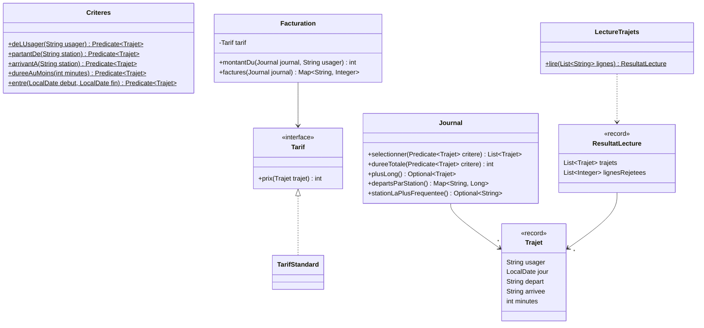

# TP3 — Les vélos du campus

TP individuel, fait hors séance. Il porte sur le cours 4, lambdas, streams et conception. À rendre avant le début de la séance des soutenances.

## Le sujet

L'université prête des vélos en libre-service. On prend un vélo dans une station, et on le rend dans une autre, ou dans la même. Chaque trajet est noté avec l'usager, le jour, la station de départ, celle d'arrivée et la durée en minutes. Vous écrivez le logiciel du service, qui sélectionne et résume les trajets, calcule les factures avec un tarif interchangeable, et lit les trajets depuis les lignes d'un fichier CSV.



Un trajet est une valeur. Les critères sont des conditions sur un trajet, que le journal utilise pour sélectionner et résumer ses trajets. La facturation reçoit un tarif, dont elle ne connaît que l'interface. La lecture transforme des lignes de texte en trajets.

Aucune de ces classes ne lit de fichier ni n'affiche quoi que ce soit, et les tests n'utilisent aucun fichier. Le fichier `tp/tp3/trajets.csv` contient pourtant une semaine de trajets, pour essayer votre code avec un programme principal. Ce programme n'est pas noté, et la question 8 indique ce qu'il doit trouver.

## Règles

- Votre code va dans `src/main/java/fr/poa/tp3/`, package `fr.poa.tp3`.
- Chaque fichier commence par cet en-tête, avant la ligne `package` :
  ```java
  /*
   * NOM Prénom — N° étudiant : 12345678
   */
  ```
- Les noms des classes et des méthodes, ainsi que l'ordre des composants des records, sont imposés. Respectez-les à la lettre.
- Ce TP s'appuie sur le cours 4. Les méthodes de `Journal` et de `Facturation` s'écrivent avec des streams, sans boucle `for` ni `while`, et celles de `Criteres` renvoient des lambdas. La lecture des lignes, à la question 8, s'écrit au contraire avec une boucle.
- Les prix sont des nombres entiers de centimes.
- Ne modifiez pas les tests fournis.

## Méthode

Avant de commencer, récupérez les nouveautés :

```bash
git pull --no-edit prof main
```

Pour chaque question :

1. Copiez le test indiqué dans `src/test/java/fr/poa/tp3/`, en remplaçant `NomDuTest`.
   macOS / Linux :
   ```bash
   mkdir -p src/test/java/fr/poa/tp3
   cp tp/tp3/tests/NomDuTest.java src/test/java/fr/poa/tp3/
   ```
   Windows (PowerShell) :
   ```powershell
   New-Item -ItemType Directory -Force src\test\java\fr\poa\tp3
   Copy-Item tp\tp3\tests\NomDuTest.java src\test\java\fr\poa\tp3\
   ```
2. Créez les classes et les méthodes demandées, d'abord vides (une méthode peut renvoyer `0`, `false` ou `null`), pour que le test compile.
3. Codez jusqu'à ce que `./mvnw test` affiche `BUILD SUCCESS`.

Lisez toujours le test, il précise ce qui est attendu. Mais les tests fournis ne vérifient pas tout, et **l'énoncé fait foi**.

Sauvegardez votre travail régulièrement :

```bash
git add src
git commit -m "TP3 : question 3"
git push
```

## Évaluation

| Critère | Points |
|---|---|
| Tests fournis | 10 |
| Tests supplémentaires | 6 |
| Lecture du code | 4 |

- **Tests fournis.** La note est proportionnelle au nombre de tests réussis.
- **Tests supplémentaires.** Ils ne sont pas fournis. Ils vérifient les règles de l'énoncé que les tests fournis ne couvrent pas, en particulier les cas limites. Lisez chaque règle attentivement.
- **Lecture du code.** On regarde l'usage des lambdas et des streams, l'encapsulation, la séparation entre la facturation et le tarif, les validations, la lisibilité et le respect des consignes de ce document.
- Une classe de tests qui ne compile pas avec votre code vaut 0. Si votre code ne compile pas du tout, seule la lecture du code est notée.

## Rendu

Un zip du dossier `src/main/java/fr/poa/tp3/`, nommé `TP3_NOM_Prenom_NumEtudiant.zip`, envoyé par mail avant le début de la séance des soutenances. Les commandes sont dans `README.md`, section « Les TP », en remplaçant `tp1` par `tp3`.

Avant d'envoyer, vérifiez que tous les tests fournis sont copiés, que `./mvnw test` affiche `BUILD SUCCESS`, et que chaque fichier commence par l'en-tête.

## Partie 1 — Les trajets et les critères

### Question 1 — Le trajet

Le test à copier est `TrajetTest.java`.

Créez le record `Trajet`, avec cinq composants dans cet ordre, `String usager`, `LocalDate jour`, `String depart`, `String arrivee` et `int minutes`. Une valeur absente est refusée par une `NullPointerException`. Un usager ou une station vide, ou fait seulement d'espaces, est refusé par une `IllegalArgumentException`, de même qu'une durée inférieure à une minute. Un trajet peut revenir à sa station de départ.

<details>
<summary>Indice</summary>

Les contrôles se placent dans le constructeur compact du record. `Objects.requireNonNull` lève la `NullPointerException`, et `isBlank()` refuse aussi un texte fait d'espaces.

</details>

### Question 2 — Les critères

Le test à copier est `CriteresTest.java`.

Créez la classe `Criteres`, avec un constructeur privé, et les méthodes statiques suivantes. Chacune renvoie un `Predicate<Trajet>`, c'est-à-dire une condition qu'un trajet vérifie ou non.
- `deLUsager(String usager)` est vraie pour les trajets de cet usager ;
- `partantDe(String station)` est vraie pour les trajets qui partent de cette station ;
- `arrivantA(String station)` est vraie pour les trajets qui y arrivent ;
- `dureeAuMoins(int minutes)` est vraie pour les trajets qui durent au moins ce nombre de minutes ;
- `entre(LocalDate debut, LocalDate fin)` est vraie pour les trajets faits entre ces deux jours, tous deux compris.

Un paramètre absent est refusé par une `NullPointerException`, dès l'appel de la méthode, et non au moment où l'on teste un trajet. Une période dont le début est après la fin est refusée par une `IllegalArgumentException`.

Les critères se combinent avec les méthodes `and`, `or` et `negate` de `Predicate`. Par exemple, `Criteres.deLUsager("Alice").and(Criteres.dureeAuMoins(30))` est vraie pour les trajets d'Alice d'au moins 30 minutes.

<details>
<summary>Indice</summary>

Une méthode peut renvoyer une lambda comme n'importe quelle autre valeur, par exemple `return trajet -> trajet.minutes() >= minutes;`. Les contrôles des paramètres se placent avant ce `return`. `isBefore` et `isAfter` comparent deux `LocalDate`.

</details>

## Partie 2 — Le journal

### Question 3 — Sélectionner

Le test à copier est `JournalSelectionTest.java`.

Créez la classe `Journal`. Son constructeur `Journal(List<Trajet> trajets)` garde sa propre copie des trajets, dans leur ordre. Une liste absente est refusée par une `NullPointerException`. Ajoutez-lui ces méthodes :
- `List<Trajet> trajets()`, qui renvoie les trajets dans l'ordre du journal ;
- `List<Trajet> selectionner(Predicate<Trajet> critere)`, qui renvoie les trajets qui vérifient le critère, dans l'ordre du journal ;
- `int dureeTotale(Predicate<Trajet> critere)`, qui additionne les minutes des trajets qui vérifient le critère ;
- `List<String> usagers()`, qui renvoie le nom de chaque usager une seule fois, dans l'ordre alphabétique.

Les listes renvoyées ne sont pas modifiables. Le critère `trajet -> true` est vrai pour tous les trajets, et `dureeTotale(trajet -> true)` additionne donc toutes les durées.

<details>
<summary>Indice</summary>

`List.copyOf` fait une copie non modifiable, et refuse une liste absente. `filter` reçoit directement le critère, puisque c'est un `Predicate<Trajet>`. `mapToInt(Trajet::minutes)` donne un stream d'`int`, qui sait faire `sum()`. Pour les usagers, enchaînez `map`, `distinct` et `sorted`.

</details>

### Question 4 — Les statistiques

Le test à copier est `JournalStatistiquesTest.java`.

Ajoutez à `Journal` ces méthodes :
- `Optional<Trajet> plusLong()`, qui renvoie le trajet le plus long, ou un `Optional` vide quand le journal n'a aucun trajet. À durée égale, c'est le premier du journal ;
- `double dureeMoyenne()`, qui renvoie la durée moyenne d'un trajet, en minutes, ou 0 quand le journal est vide ;
- `List<Trajet> lesPlusLongs(int n)`, qui renvoie les `n` trajets les plus longs, du plus long au plus court, dans une liste qu'on ne peut pas modifier. À durée égale, les trajets gardent l'ordre du journal. S'il y a moins de `n` trajets, la méthode les renvoie tous. Un `n` négatif est refusé par une `IllegalArgumentException`.

<details>
<summary>Indice</summary>

`max` reçoit un comparateur, renvoie un `Optional`, et garde le premier élément en cas d'égalité. Sur un stream d'`int`, `average()` renvoie un `OptionalDouble`, qui a lui aussi une méthode `orElse`. `sorted` accepte un comparateur, et ne change pas l'ordre des éléments égaux. `limit(n)` garde les `n` premiers.

</details>

### Question 5 — Regrouper

Le test à copier est `JournalRegroupementTest.java`.

Ajoutez à `Journal` ces méthodes :
- `Map<String, Long> departsParStation()`, qui compte les trajets partis de chaque station ;
- `Map<String, Integer> minutesParUsager()`, qui additionne les minutes de chaque usager, avec les usagers dans l'ordre alphabétique ;
- `Optional<String> stationLaPlusFrequentee()`, qui renvoie la station d'où partent le plus de trajets. En cas d'égalité, c'est la première dans l'ordre alphabétique. Un journal vide n'en a aucune.

<details>
<summary>Indice</summary>

`Collectors.groupingBy` regroupe par clé. Avec `Collectors.counting()`, il compte, et avec `Collectors.summingInt(...)`, il additionne. Un argument de plus, placé au milieu, fabrique la `Map`, comme `TreeMap::new` pour des clés triées.

Pour la station la plus fréquentée, partez des départs comptés, rangés dans une `TreeMap`. Un stream sur son `entrySet()` donne des couples `Map.Entry`, que `Map.Entry.comparingByValue()` compare selon leur valeur. `max` garde le premier couple en cas d'égalité, c'est-à-dire la première station dans l'ordre alphabétique. `map(Map.Entry::getKey)` donne enfin son nom.

</details>

## Partie 3 — La facturation

### Question 6 — Le tarif

Le test à copier est `TarifStandardTest.java`.

Créez l'interface `Tarif`, avec une seule méthode, `int prix(Trajet trajet)`, qui renvoie le prix d'un trajet en centimes.

Créez ensuite la classe `TarifStandard`, qui implémente `Tarif` avec le tarif du service. Les 30 premières minutes sont gratuites. Au-delà, chaque tranche de 30 minutes commencée coûte 1 €, soit 100 centimes. Un trajet de 31 à 60 minutes coûte donc 100 centimes, et un trajet de 61 à 90 minutes 200 centimes.

<details>
<summary>Indice</summary>

Calculez d'abord les minutes payantes. Pour deux entiers positifs, `(a + b - 1) / b` divise `a` par `b` en arrondissant vers le haut, ce qui donne le nombre de tranches commencées. Donnez un nom aux nombres du tarif, avec des constantes.

</details>

### Question 7 — La facturation

Le test à copier est `FacturationTest.java`.

Créez la classe `Facturation`. Son constructeur `Facturation(Tarif tarif)` reçoit le tarif à appliquer, et refuse un tarif absent par une `NullPointerException`. Ajoutez-lui ces méthodes :
- `int montantDu(Journal journal, String usager)`, qui additionne les prix des trajets de cet usager, ou renvoie 0 s'il n'en a fait aucun ;
- `Map<String, Integer> factures(Journal journal)`, qui associe à chaque usager du journal la somme des prix de ses trajets, avec les usagers dans l'ordre alphabétique. Un usager qui ne doit rien a quand même sa facture, à 0.

`Facturation` ne connaît que l'interface `Tarif`, et jamais `TarifStandard`. C'est ce qui permet aux tests de remplacer le vrai tarif par une doublure, écrite ici avec une lambda. Avec `new Facturation(trajet -> 100)`, chaque trajet coûte 100 centimes, quelle que soit sa durée.

<details>
<summary>Indice</summary>

`tarif::prix` est une référence de méthode sur un objet, qui donne le prix d'un trajet. Elle se passe à `mapToInt` comme à `Collectors.summingInt`. Pour les trajets d'un usager, les critères de la question 2 servent encore.

</details>

## Partie 4 — La lecture des trajets

### Question 8 — Lire les lignes d'un fichier

Le test à copier est `LectureTrajetsTest.java`.

Chaque soir, les bornes des stations exportent les trajets dans un fichier CSV. Le programme principal lit ce fichier avec `Files.readAllLines`, puis passe ses lignes à `LectureTrajets`. La lecture se teste ainsi avec de simples listes de textes, sans aucun fichier.

```
usager;jour;depart;arrivee;minutes
Alice;2026-11-30;Gare;Bibliothèque;12
Bruno;2026-11-31;Résidence;Stade;45

Alice;2026-12-01;Bibliothèque;Gare;15
Chloé;2026-12-01;Gare;Stade;soixante-dix
David;2026-12-03;Gare;Résidence;31
```

Créez le record `ResultatLecture`, avec deux composants, `List<Trajet> trajets` et `List<Integer> lignesRejetees`. Il garde des copies non modifiables des deux listes qu'il reçoit.

Créez ensuite la classe `LectureTrajets`, avec un constructeur privé, et sa méthode statique `ResultatLecture lire(List<String> lignes)`.
- La première ligne est un en-tête, qui n'est pas un trajet.
- Chaque ligne suivante décrit un trajet en cinq champs séparés par des points-virgules, dans l'ordre des composants de `Trajet`. Le jour est au format AAAA-MM-JJ.
- Une ligne vide, ou faite seulement d'espaces, est ignorée.
- Une ligne invalide est rejetée, et la lecture passe à la suivante. Une ligne est invalide quand elle n'a pas cinq champs, quand le jour ou la durée est illisible, ou quand le trajet ne respecte pas les règles de la question 1.
- La méthode renvoie les trajets lus, dans l'ordre, et les numéros des lignes rejetées, en comptant l'en-tête comme ligne 1.

Dans l'exemple, la ligne 3 est rejetée parce que le 31 novembre n'existe pas, et la ligne 6 parce que sa durée est illisible. La lecture renvoie donc les deux trajets d'Alice et celui de David, et les lignes rejetées 3 et 6.

Pour essayer la lecture sur un vrai fichier, écrivez un programme principal dans une classe `Essai`, du même package. Il n'est pas noté. Lancé depuis le dossier `poa`, il lit `tp/tp3/trajets.csv`, qui suit le même format.

```java
public static void main(String[] args) throws IOException {
    List<String> lignes = Files.readAllLines(Path.of("tp/tp3/trajets.csv"));
    ResultatLecture resultat = LectureTrajets.lire(lignes);
    System.out.println(resultat.trajets().size() + " trajets lus, lignes rejetées : " + resultat.lignesRejetees());
}
```

Sur ce fichier, la lecture doit trouver 17 trajets et rejeter les lignes 15, 18 et 20. Vous pouvez ensuite afficher les factures avec le tarif standard. Alice ne doit rien, et Bruno doit 4 €.

<details>
<summary>Indice</summary>

Parcourez les lignes avec une boucle, à partir de l'index 1, et découpez chacune avec `split(";")`. `Integer.parseInt` lève une `NumberFormatException`, et `LocalDate.parse` une `DateTimeParseException`. `NumberFormatException` hérite de `IllegalArgumentException`, que lève aussi le constructeur de `Trajet`. Placez le `try` dans la boucle, pour qu'une ligne rejetée n'arrête pas la lecture.

</details>
